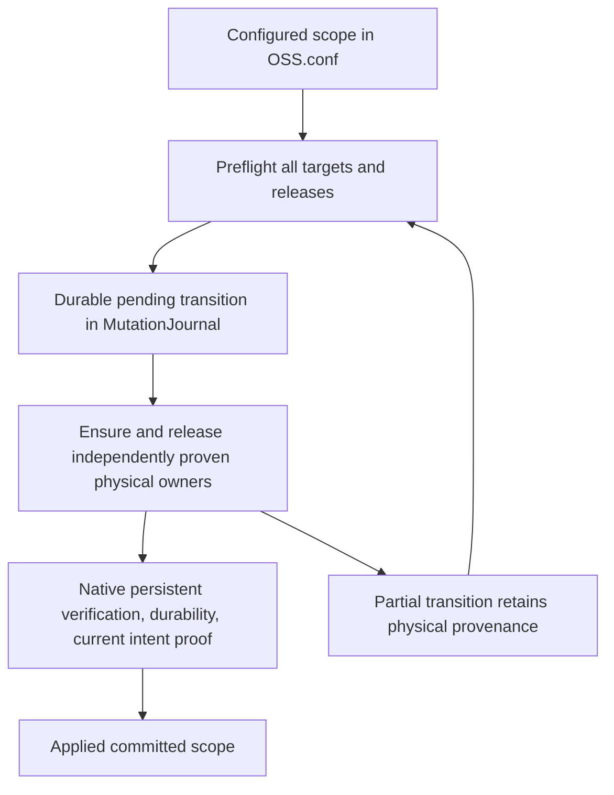

# Graphical scope validation

Follow-up base: `a0f5ff85341e609f889342f51231f1c8e1a6de6c`.
Current follow-up restores native SessionOnly KDE/XFCE and FLY convergence,
retains global GNOME/FLY/DM inverse release, and makes scope apply validation-only.

The lasting contract is in [graphical-scope-transactions.md](graphical-scope-transactions.md).
Configured intent does not grant physical ownership. Committed global scope confirms system resource verification, independently of
SessionOnly convergence; scope declarations validate without it. Partial/failed transitions preserve
recoverable provenance, not an assertion of continuing protection.

## Production areas

DE: policies, session/global coordinator, GNOME/FLY physical transactions,
Required dependencies, shared scope/journal, joint rollback and removal gates.
DM: typed scope/compliance, complete inventory, fixed-route autologin block
transaction, current state/native verification, daemon orchestration, platform
profiles/executable resolution, shared journal/scope, joint rollback, package
removal gates and defaults/localization. The old unjournaled DM writers are removed.

## Backend rollback matrix

| Backend / policy | Contract | Validation boundary |
| --- | --- | --- |
| GNOME root settings | Supported joint exact key/lock/artifact inverse | Native dconf/GSettings containers; live GNOME Shell NOT VERIFIED |
| FLY root settings | Persistent ensure/inverse; live runtime NOT_VERIFIED | Filesystem/fault tests; native FLY NOT VERIFIED |
| KDE / XFCE user settings | SessionOnly native setters/readback; no rollback or journal | Contract tests; live sessions NOT VERIFIED |
| DE scope / compliance | NotEnrolled | Logical checkpoint / Required tests |
| KDE media controls | NotEnrolled; native apply restored | Fail-closed tests |
| SDDM / GDM / LightDM autologin | Supported joint exact owned-block release | Native persistent inspection; live DM NOT VERIFIED |
| DM scope / compliance | NotEnrolled | Logical checkpoint / Required tests |
| Unknown routes/actions/policies | Unsupported / fail-closed | Journal and rollback tests |

DM journal undo stores manager, route=0, sorted LightDM seats, separator,
created_file, creation_device/inode, had_applied and phase ensure/release.
Policy/resource identity and marker ID are checked independently. It stores no
foreign configuration snapshot or arbitrary journal-controlled path. Recovery
reproves the exact owned block; an interrupted release closes before a new
mutation ID is enrolled. Changed/unproven blocks refuse mutation; replacement
containers are preserved. Prepared is durable before publication; actual native
verification and fsync precede Applied. Root CAS plus FIC-locking retains the
accepted final-proof-to-rename/unlink race against unrelated writers.

## Follow-up evidence

* Full Debian12 Docker configure/build and CTest PASS; final commands/results
  are recorded in HANDOFF. Regression tests cover SessionOnly aggregation/new
  sessions, scoped planner selection/Required blocking, scope transition matrix,
  fresh dependent apply, native setters/readback, media NotEnrolled disable,
  GNOME/FLY recovery and foreign-state preservation, and DM already-disabled
  administrator configuration still acquiring/releasing a FIC block.
* Native GNOME dconf/GSettings journal lifecycle PASS on Debian12, Ubuntu24.04
  and ALT p11 snapshots with installed real packages. ALT's stock dconf profile
  and database tree are preserved separately inside a disposable container to
  isolate the probe's fixture; two initial harness refusals are not backend
  failures. Production guards remain intact.
* Native DM persistent loader/journal ensure/recovery/release PASS on Debian12,
  Ubuntu24.04 and ALT p11. No manager is launched or restarted.
* Current evidence: ignored `build-prelogin-validation/dm-evidence/session-followup-*`.
  Actual KDE/XFCE/FLY sessions and live DM/GNOME Shell remain NOT VERIFIED;
  Astra native tests are deferred to the administrator. No host mutation.

## Previous DE/DM evidence (before this follow-up)

DE evidence was completed before the first commit: full Debian12 build,
173/173 CTest, native GNOME lifecycle on Debian12/13 and Ubuntu24/26. No host
policy mutation. Removed Docker image tags do not imply a new verification run.

| Image | DE native packages (first commit) | DM native packages / result |
| --- | --- | --- |
| Debian12 | dconf 0.40.0-4, schemas43.0-1 PASS | sddm0.19.0-5, gdm3 43.0-3, lightdm1.26.0-8 PASS |
| Debian13 | dconf0.40.0-5, schemas48.0-1 PASS | sddm0.21.0+git20250502.4fe234b-2, gdm3 48.0-2, lightdm1.32.0-6+b2 PASS |
| Ubuntu24.04 | dconf0.40.0-4ubuntu0.1, schemas46.1-0ubuntu1 PASS | sddm0.20.0-2ubuntu4.2, gdm3 46.2-1ubuntu1~24.04.9, lightdm1.30.0-0ubuntu14 PASS |
| Ubuntu26.04 | dconf0.49.0-4, schemas50.0-1ubuntu2 PASS | sddm0.21.0+git20250502.4fe234b-2ubuntu3, gdm3 50.1-0ubuntu0.1, lightdm1.32.0-6ubuntu4 PASS |
| ALT p11 | NOT VERIFIED: mirror failed in DE pass | sddm0.21.0-alt3, gdm48.0-alt5, lightdm1.32.0-alt15, Qt6-devel6.11.2-alt1 PASS |

DM native probe tests native GDM GKeyFile flags and defeating runtime override,
LightDM wildcard/specific/pattern seats, guest and drop-in configuration, an
independently compiled unmodified upstream SDDM ConfigReader, restart, retained
owners, foreign settings and removal of genuinely created empty primary files.
No DM daemon is launched/restarted. Administrative success separately reports
live_runtime=NOT_VERIFIED. Native probes require an explicit container-only
marker, root and /.dockerenv; they are excluded from ordinary CTest.

Full DM build and CTest after the final route-overflow and permission guards:
**174/174 PASS**, 71.57s, after the final ALT route/alias and inspection-time
input drift corrections. Container drops DAC_OVERRIDE/DAC_READ_SEARCH and sets
Git safe.directory=/src. Generated removal scripts, PAM packaging and prelogin
lifecycle checks are included in that suite. Native inventory/service switching
is covered by contract mocks; containers prove loaders and file/journal lifecycle,
not a live systemd display-manager session.

Native image tags: `fic-deb-builder:debian12-final`, `debian:13-slim`,
`ubuntu:24.04`, `ubuntu:26.04`, `registry.altlinux.org/p11/alt:latest`.
The final ALT test uses a cache snapshot of that real p11 image, not a simulated
package database. Exact package versions above come from dpkg-query/rpm output.
SDDM witnesses are compiled with the unchanged upstream ConfigReader.cpp/.h
matching installed 0.19/0.20/0.21. Qt5 is used for 0.19, Qt6 for 0.20/0.21.
The native gate scripts expect those files mounted at /upstream; production
does not fetch or execute upstream source.

## Unverified / unsuccessful checks

| Check | Status |
| --- | --- |
| Live DM settings cached by a running process | NOT VERIFIED; accepted explicit persistent/runtime boundary |
| Live GNOME Shell / FLY / KDE / XFCE | NOT VERIFIED |
| Actual FIC package-manager install/erase lifecycle | NOT VERIFIED; generated DEB/RPM preflight/release failure scripts pass |
| First Ubuntu24 DM apt installation | INFRA_ERROR: HTTP connection failure; retry native probe PASS |
| Ubuntu26 HTTP libpng fetch | INFRA_ERROR; official HTTPS/cache recovery, native gate PASS |
| ALT HTTP package downloads | Interrupted/stalled; signed-index BLAKE2b/size HTTPS cache recovery, native gate PASS without disabling apt/RPM verification |
| Initial ALT route witness | Fail-closed on unverified path; compiled SDDM/GDM routes corrected and re-tested; native gate PASS |
| Standalone Python packaging commands without complete arguments | Harness invocation error; registered CTest command is authoritative |
| Initial full DM CTest | 172/174; stale deleted-backend static paths and mandatory DM executable validator fixed; final 174/174 PASS |

ALT also tests refusal of a replaced `/var/run` alias before primary writes,
then restores the stock alias. Backend verification rechecks source snapshots
after native inspection; a mocked concurrent administrator write must fail.
Full build log: `build-prelogin-validation/dm-evidence/dm-alt-route-build.log`;
full CTest: `dm-alt-routes-ctest.log`; final ALT native log:
`native-alt-routes-final.log`. Evidence artifacts are intentionally outside Git.
