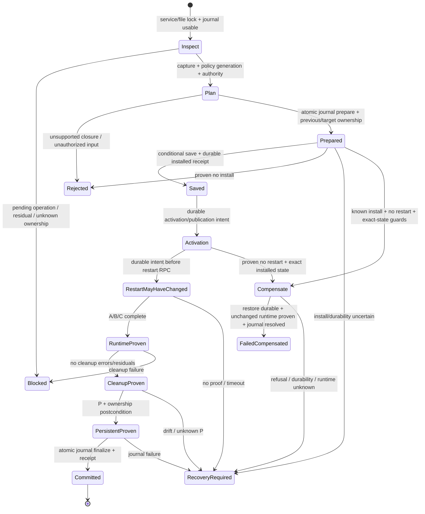

# SSH Verified Transaction Lifecycle — архитектурный проект

## 1. Executive summary

**Статус: проект расширенного lifecycle; Stage 1/2 и bounded Debian integration
описаны в §22/23 и последнем разделе. Проектные durable restart intent/REFRESH
не реализованы текущим schema 2 и не заявляются как готовые.** Аудит базы `36cbfd8c17c4c7f6eb8fe77d341243cabb14d616`.
Production, API, journal schema и поведение политик этим документом не изменяются.

Рекомендация: отдельный **SSH transaction coordinator** (вариант B), переиспользующий
`SshConfigTransaction`/`AtomicFileWriter` для conditional persistence, managed-block
операции для ownership и существующий adapter/тот же generic engine для активации.
В первой версии — одна policy operation под общей service-wide сериализацией;
в дальнейшем — пакетное планирование поверх того же coordinator (ограниченный C).
Простая замена reload на adapter архитектурно некорректна.

Целевая последовательность:

```text
authorize request + serialize + recover unresolved service operation
→ capture/ownership proof + plan + authorize complete planned closure
→ durable Prepared + write intent
→ conditional save + durability + installed-state receipt
→ publish/validate RO inputs → durable restart intent → verified restart
→ cleanup → persistent/ownership postcondition → durable journal finalization
```

Компенсация — отдельная условная ветвь, **не** обязательное продолжение любой ошибки.
До доказанного отсутствия restart и сохранности конкретного installed state она
запрещена; после runtime promotion либо неизвестного runtime v1 сохраняет provenance
и требует reconciliation. После crash старый pre-attempt snapshot не восстанавливается.

Полный `Success` требует persistent + runtime + ownership + cleanup + journal proof.
`Applied` в нынешнем journal означает ownership lifecycle, а не само по себе proof
конфигурации действующего sshd. Нужен отдельный durable service checkpoint **в том же
MutationJournal**, не второй ownership store. Без изменения его schema нельзя честно
восстановить требуемые phase/runtime facts. Общие MutationStatus расширять не требуется.

До интеграции необходимо исправить текущие дефекты Prepared/REFRESH/fast-path,
подтверждённые ниже. Их исправление — отдельные будущие коммиты.

## 2. Основания и реальные call graph

Authoritative descriptions: [adapter](ssh-verified-activation-adapter.md),
[generic engine](verified-config-service-activator.md),
[исторические native результаты](verified-config-openssh-native-validation.md).
Ограничения исторических запусков сохраняются; этот аудит не новый native acceptance.

| Область | Проверенный код / точки входа |
|---|---|
| Apply | `fic/src/modules/net/ssh/Ssh.cpp`: `Ssh::apply`, `analyzeOwnership`, `finishPrepared`, `dropNewPrepared` |
| Persistence transaction | `SshConfigTransaction.{h,cpp}`: `runSshConfigTransaction`, `compensateRestore`, `reconcileRestoredRuntime` |
| Snapshot/planning | `SshConfigFile.{h,cpp}`: `loadConfig`; shared `FileHandler::saveFileIfUnchanged` |
| Native test commands | `SshRuntime.{h,cpp}`: `loadEffectiveConfiguration`, `policyValueCompliance`, `activateIfRunning`; `SshConfigAudit.{h,cpp}` |
| Ownership | `SshManagedBlock.{h,cpp}`: parser/upsert/remove, `checkSshDisabledProvenance`, `restoreSshDisabledLines` |
| Release | `SshRollback.{h,cpp}`: `undoSshManagedPolicyMutation`, conditional restore/durability helpers |
| Journal | `fic/src/rollback/{DaemonMutationJournal,MutationJournal,MutationRecord}.{h,cpp}`; schema 2 |
| Disable/finalization | `RollbackExecutor.cpp`: `undoSshManagedPolicy`, `rollbackPolicyBeforeDisable`; `daemon/PolicyDisableFlow.cpp` |
| Atomic I/O | `fic-common/fic-core/{include/fic/core/fs,src/fs}/AtomicFileWriter.{h,cpp}`: capture/match/write/barriers |
| Verified engine | `service/VerifiedConfigServiceActivator.cpp`, `VerifiedConfigActivationProof.h`, `VerifiedConfigSystemd.*` |
| SSH proof | `service/ssh/{SshVerifiedActivationAdapter,SshVerifiedInputClosure}.{h,cpp}`, `SshPersistentMetadata.h` |
| Trust/incident/public result | `SshInputAuthority.h`, `incident/PolicyIncidentReporter.*`, `IncidentController.cpp`, `fic/policy/PolicyApplyResult.h` |

### 2.1. Текущий apply (реальное, не желаемое поведение)

1. `Ssh::apply`: проверить parameter, захватить process-local `sshBackendMutex`,
   получить policy value; определить ScalarFirstWins/MultiValue по существующему classifier.
2. `SshConfigFileHandler::loadConfig` захватывает `AtomicTargetState`, разбивает
   bytes на строки, отвергает malformed/unsupported markers; main global section до Match.
3. Получить usable witness-aware `DaemonMutationJournal`; `activeRecords(policy)`
   включает **Prepared, Applied, RollbackFailed**. Journal недоступен — отказ до mutation.
4. Newest record: exact owned directive line + provenance IDs wrappers. Payload с
   duplicate IDs запрещён даже без сохранившихся wrappers. Исчезнувшие wrappers
   считаются освобождёнными; unknown actual IDs/modified block — fail-closed.
5. Prepared с сохранившимися owned artifacts: `finishPrepared` вызывает `sshd -T`,
   state-bound parent-directory durability, reload-if-active, `commitMutation`.
   Без artifacts — validation/reload, commit, затем discard и обычное применение.
   Здесь ещё нет selected-policy proof recovered target перед commit/reload.
6. Если desired value изменилось: сначала **полный release прежней policy** через
   `undoSshManagedPolicyMutation`, пометить старые records RolledBack, перечитать main;
   только затем планировать новое значение. Это две операции с промежуточным
   освобождённым состоянием, а не in-place refresh и не атомарная смена значения.
7. До compliance fast-path проверить отсутствие malformed/orphan markers.
   `isEffectivelyCompliant` использует новый `sshd -T -f config` и conditional audit:
   это **persistent effective configuration**, не запрос к работающему sshd.
   При compliance вернуть true без write/enrollment/reload, включая foreign compliant.
8. Построить planned lines: scalar sub-block в начале main; Port — дополнительно
   обернуть global occurrences main вне FIC blocks/wrappers в новые FIC_DISABLED.
   Included files/Match не редактируются. Additive Port из Include может сделать
   postcondition невыполнимой, тогда transaction пытается компенсировать main.
9. Ветка `!changed && hasExistingRecord` возвращает true независимо от проваленной
   выше effective compliance (см. R5). Иначе `recordPreparedMutation` **до write**;
   payload содержит applied line и только `newWrapperIds` этой попытки.
10. `runSshConfigTransaction`: preContent из load snapshot → planner → optional
    beforeWrite → `saveFileIfUnchanged` → durability → `runtime.validateConfiguration`
    → callback managed-line/effective-value → `activateIfRunning`.
    Callback смотрит handler.lines (план), а не заново ownership прочитанного файла;
    `sshd -T` отдельно читает доступную по пути конфигурацию. Это не pinned verified proof.
11. `validateConfiguration` в действительности запускает **`sshd -T`**, не отдельный
    `-t` (несмотря на некоторые комментарии `-t/-T`). Reload = `systemctl is-active`
    по profile units → `reload` первой active → повторный is-active. Нет нового PID,
    InvocationID, READY либо свидетельства применения loaded values.
12. Любая post-install ошибка приводит к попытке conditional exact preContent restore,
    его durability, `sshd -T` и reload restored state. Возможные результаты сжаты
    в `ok/conflict/message`; `conflict` описывает initial CAS refusal, не все restore errors.
13. `!transaction.ok` → **безусловный `dropNewPrepared`** → false. Успех transaction
    → `commitMutation(id)` (`MutationStatus::Applied`); при ошибке commit return false
    без discard, что правильно сохраняет unresolved provenance.

### 2.2. Текущий rollback/disable

```text
rollbackPolicyBeforeDisable → activeRecords
 → undoSshManagedPolicy [rollbackBackendMutex, ДРУГОЙ mutex]
 → undoSshManagedPolicyMutation
 → ownership parser / exact applied line / wrapper ID subset proof
 → shared runSshConfigTransaction(remove sub-block + unwrap remaining owned wrappers)
 → sshd -T + reload-if-active
 → executor setStatus(RolledBack)
 → disablePolicyAfterLookup сохраняет DISABLE, только если rollbackCompleted()
```

Modified managed line/unknown or duplicate wrapper IDs = Conflict, файл не меняется.
Частичное исчезновение artifacts не требует их реконструкции; release завершается
по сохранившейся части. Если всё исчезло: NothingToDo лишь **после** validation,
state-bound durability и reload-if-active. При runtime failure nothingToDo сбрасывается.
При failure executor сохраняет RollbackFailed; при journal finalization failure
не объявляет success. После crash повтор идемпотентно освобождает оставшиеся artifacts
или согласует runtime в NothingToDo ветви; нет durable записи, что начат именно release.
Прямой release при value change вызывается внутри apply mutex; executor release — под другим.

### 2.3. Что реально доказывает adapter сейчас

Stock Debian12/13 `ssh.service`, уже active Type=notify/NotifyAccess=main,
одинаковый mount namespace с manager, разрешённый launch, executable trust,
заранее подготовленные private publication boundaries. Нет автоматического
создания boundary; shared parent без подходящей границы остаётся unsupported.
EnvironmentFile explicit `/etc/default/ssh` с literal empty SSHD_OPTS; ограниченный
Include grammar, exact directory manifests/negative sets, explicit HostKey + .pub,
весь Match отвергается. Другие distro profiles — Unsupported, не fallback restart.

Semantics (`sshd -T` + selected policies) проверяется до restart и на RO snapshot;
READY/process executable/launch/snapshot observation дают ограниченный runtime proof.
C не означает query live sshd values, доказательство PAM/authentication либо всех
будущих reads. После cleanup sshd может перечитать drifted original на connection.
A/C выставляются Proven после полного primary success; отдельный ранний READY
не обязан отразиться в них при поздней interference. P повторно читает оригиналы,
проверяет reference и metadata baseline. Engine возвращает оригинальный B целиком.
`activationAttempted` = вход в engine, **не** доказательство отправки restart.

## 3. Инварианты, которые сохраняются

* Ownership — exact recorded FIC sub-block и доказанные wrappers, не весь sshd_config.
  Foreign lines/Include/другие policies/исчезнувшие artifacts не реконструируются.
* Unknown/malformed provenance блокирует mutation раньше compliance fast-path.
* Permission to activate внешний input ≠ FIC ownership ≠ effective selected value
  ≠ operation-local metadata stability. Эти четыре доказательства не взаимозаменяемы.
* Prepared durable до возможного изменения файла. Installed ≠ durable; failed operation
  не доказывает отсутствие эффекта. Journal Indeterminate никогда не operational.
* Conditional restore опирается на **выданный writer** installedTargetState,
  не свежезахваченный «текущий expected state» и не один SHA.
* CAS существующего AtomicFileWriter — optimistic precondition + rename, не атомарность
  против noncooperating root writers; FIC-locking не устраняет external TOCTOU.
* A/B/C/P независимы; CleanupFailed/primary/READY/errors/residuals не переписываются.
* Policy layer не вызывает containment; incident определяется summary/reporting layer.
  Required dependency удовлетворяется только полноценным Applied.
* Никакого stop/start остановленного sshd, установки OpenSSH или destructive cleanup
  ради формального успеха. Legacy distro behavior не выдаётся за verified guarantee.

## 4. Подтверждённые риски и изолированные воспроизведения

| ID | Факт / исполнимый путь | Последствие | Уровень evidence |
|---|---|---|---|
| R1 | write installed → post-write `-T` fail → original edited externally → restore CAS refused → transaction false → dropNewPrepared/discard | Owned markers остаются, journal provenance исчезает; следующий apply orphan-fails | Воспроизведено на production objects + fake runner |
| R2 | Applied Port с W1 → добавить чужой Port → same-value REFRESH создаёт W2 → prepareMutation upserts тот же record, заменяет payload на newWrapperIds={W2} | apply true/Applied, rollback Conflict на сохранившемся W1 | Воспроизведено |
| R3 | Изменить `FIC_DISABLED_LINE` Port 22→2022, сохранить известный ID | ID-only provenance разрешает unwrap изменённого тела, digest тела в SSH payload отсутствует | Воспроизведено; gap относительно строгого desired ownership-safe contract |
| R4 | apply mutex и executor rollback mutex — разные function-local statics | Не сериализуют один ресурс; journal/plan могут race при будущей parallel execution; process mutex не защищает второй процесс | Статический call graph; реальная concurrent race не запускалась |
| R5 | Owned scalar line уже desired; добавить weakening Match; effective check NonCompliant, upsert changed=false | `!changed && hasExistingRecord` возвращает true, несмотря на известное нарушение | Воспроизведено; отдельный assert NonCompliant перед apply=true |
| R6 | Prepared recovery reload/commit раньше проверки desired effective value; no-artifact recovery делает commit→discard | Applied не является proof runtime/selected policy; crash между commit/discard неоднозначен | Статически подтверждено |
| R7 | Current compensation после attempted reload/ошибки reload повторно reload-ит historical config | Отсутствие READY/error не доказывает неизменность runtime; exact bytes restore не возвращает процесс | Статически подтверждено; legacy tests допускают restore при failed reload |
| R8 | AtomicTargetState не содержит mount ID, nlink, mtime/ctime, xattrs; capture читает stat один раз перед bytes; сохраняются uid/gid/mode, не ACL/xattrs | Его нельзя приравнять к полному metadata witness adapter или допускать arbitrary historical file restore | Проверены declaration, capture/match/write implementations |

R1 воспроизведение: fresh Port apply, fake `-T` #2 возвращает failure и дописывает
comment к уже installed файлу. Restore отвергнут existing CAS, external comment и FIC
markers сохраняются, `MutationJournal::records()` пуст. Это **не** runtime/native proof
и не атака на host SSH; показывает точный provenance-loss путь без правки production.
R2/R3 использовали те же TempTree/JournalOverride fixtures. R5 отдельно проверяет
`policyValueCompliance == NonCompliant`, затем фактический `apply()`.

Будущие regression tests должны проверять file+ownership+record, а не только bool
и наличие error. Существующие tests reload/validation compensation проверяют удачное
восстановление preContent, но не покрывают R1. Prepared tests покрывают artifacts,
no-artifacts и drifted block, но не durable service intents или restart outcome.

## 5. Сравнение вариантов

| Критерий | A: расширить runSshConfigTransaction | B: SSH coordinator | C: persistent phase + общий runtime phase |
|---|---|---|---|
| Security/outcomes | Опасна drop-in замена reload: старый bool и unconditional restore | Явные proofs/права на каждый шаг; предпочтительно | Хорошо, если все pending policies и global gate durable |
| Crash consistency | Всё равно требует typed outcome, journal checkpoint и новых boundaries | Один владелец state machine; existing journal extension | Нужны group snapshot, atomic group finalize и scheduler protocol |
| Ownership | Старые planner/release полезны, но REFRESH сейчас lossy | Переиспользовать planner, previous/target provenance сохранять | Общий planned image, release разных owners сложнее |
| Journal compatibility | Нет честной zero-schema integration полного lifecycle | Сохранить statuses, расширить schema и atomic SSH operations | Дополнительно group phases / policy generation |
| Изменения/tests | Мало только при неполном контракте; полный контракт раздует helper | Средний объём, ясные unit/crash seams | Большой объём, затрагивает registry execution timing |
| Rollback | Старый expected-value callback непригоден release | Отдельный Release intent, общая persistence/activation машина | Batch disable с учётом remaining owners/dependencies |
| Parallelism | Один mutex недостаточен | Один service/file lock; разные сервисы могут развиваться отдельно | Сложное владение batch/scheduler |
| Distro | Безопасный opt-in capability gate нужен всем | Debian12/13 verified; Ubuntu/ALT отдельно legacy | Те же границы, batch сам поддержки не добавляет |
| Restart cost | До пяти restart на module apply | V1 столько же; reuse receipt для idempotent повторов | Один restart на заранее известный coherent batch |
| SSSD/расширение | Риск общего монолитного helper | Переиспользовать generic activation, не SSH ownership/parser | Возможен общий orchestration позже, без преждевременной унификации |

**Выбор B, затем bounded batching поверх B.** Не вводить production двухфазное
применение всех policies до окончания recovery/release контракта: сегодняшняя модель
считает policy Applied сразу после её вызова. Скрытая общая phase C это нарушит.

## 6. Контракт результата и совместимость

| Outcome | Что доказано | Полный Success / public projection |
|---|---|---|
| VerifiedApplied | Planned persistent durable, ownership, A/B/C/P, cleanup, journal finalization | Да; bool true / Applied |
| VerifiedUnchanged | Всё выше из валидного receipt + свежих проверок той же InvocationID/closure/launch, без новой write | Да; bool true / Applied; foreign compliance не получает ownership |
| ConfiguredInactive | Durable desired persistent и ownership/journal; отсутствие active service достоверно, runtime not applicable | Отдельный результат, **не VerifiedApplied** |
| DeferredRuntime | Runtime требовался, но не доказан / разрешение restart отсутствует | Не Success; unresolved service operation |
| PersistentDrift | B runtime success, P mismatch | Не Success; сохранить B, service gate RecoveryRequired |
| CleanupBlocked | CleanupFailed/residuals независимо от primary success | Не Success; mount barrier/manual action |
| JournalUncertain | OS effects могли состояться, finalization недоказана | Не Success; operational journal gate закрыт |
| RejectedNoEffect | До write / CAS отказ; no service changes доказаны | Не Success; сохранить предыдущий proven state, разрешить retry |
| FailedCompensated | Exact original durable restored, runtime reconciled/unchanged доказан, journal resolved | Операция применения всё равно failed; компенсация имеет собственный successful outcome |
| RecoveryRequired | Effects/ownership/runtime неизвестны либо compensation incomplete | Не Success; запрет следующей SSH mutation |

**Нельзя** спрятать ConfiguredInactive в bool true и написать «политика применена»
без уточнения scope. Нельзя подавить incidents через FailureOrigin: нынешний enabled
+ Failed всегда реагирует своей violation_severity. Рекомендация для configure-only
политик — будущий `PolicyApplyStatus::Deferred` с typed diagnostic `ConfiguredInactive`,
отдельными counts и without-success summary; Required не удовлетворён. Это потребует
producer/CLI/GUI/IPC tests/docs. До этой работы strict-mode projection — false/Failed
с явным diagnostic, поэтому массовое включение strict mode на stopped-service хостах
не допускается. Для явно объявленного MustBeRunning stopped = Failed, обычная severity.
Вопрос включения нового public Deferred выносится на approval до implementation.

Для full Success нужна проверка persistent/ownership не только P adapter: его P
проверяет caller reference/metadata, но не journal marker provenance. Coordinator
проверяет exact target markers + surviving other owners, затем finalize под тем же
lock и ещё раз сверяет current persistent/service identity. Между финальной проверкой
и return остаётся external race: гарантируется наблюдённый согласованный результат,
а не глобальная linearizability filesystem/systemd/journal.

## 7. Целевая state machine apply



No-install abort удаляет только **fresh** Prepared после доказанного отсутствия
artifacts/effects. Для REFRESH abort восстанавливает предыдущий owned payload и статус,
а не discard общего ID. Current semantics никогда не интерпретируются из одного bool.

Перед первой write нужно preflight planned grammar, reference coverage, launch capability,
private boundaries, service availability и policy prerequisites. Это уменьшает ошибки
после save, но не обещает неизменность preflight до action. Native semantic proof может
требовать публикации уже сохранённого target; отказ на этой стадии всё равно обработан.

## 8. A/B/C/P mapping и дальнейшие действия

Во всех строках audit содержит operation ID, phase, независимые facts и B целиком;
incident — существующий reporter/controller согласно §16. `Keep` означает сохранить
Prepared/previous ownership **и** durable unresolved service checkpoint.

| Ситуация | Доказано / неизвестно | Compensation | Journal / next SSH / incident / reconciliation |
|---|---|---|---|
| A/B/C/P success + cleanup | Runtime текущей операции доказан; journal ещё не finalized | Нет | Finalize, затем разрешить следующую; без нового incident |
| Adapter refused, activationAttempted=false | Engine/restart не вызывался; persistent уже мог быть saved | Условно до runtime только по §9 | Abort/restore record только после доказанных postconditions; иначе Keep + recovery |
| Engine вызван, B до restart | Из нынешнего attempted flag это **не следует**; нужны phase evidence | Только typed NotRequested | Пока API не расширен — Keep, no compensation, gate closed |
| Restart requested, READY нет | Новый процесс мог стартовать/частично читать original после cleanup; old может быть остановлен | Нет в v1 | Keep; observe systemd/job bounded; отдельная authorized reactivation; runtime-not-proven incident |
| B primary Success, A/C Proven, P NonCompliant | Snapshot runtime работал, original drifted | Нет | Keep; ownership пересмотреть по live markers, service-wide barrier, drift incident; не reload |
| B success, P NotProven | Persistent неизвестен | Нет | Keep, read-only investigation; не переобъявлять disk reference |
| B CleanupFailed, primary Success | Runtime promotion может быть доказан; original может быть скрыт | Нет | Keep, mount barrier; запрет write/rename/restart; administrative cleanup interface §11 |
| C не доказана до restart | Target не прошёл semantics / unsupported | Условно, если NotRequested и прочие guards | Preserve primary reason; failed-compensated либо Keep; отозвать общий proof |
| C/runtime proof потерян после restart | Ранние predicates не равны финальным A/C | Нет | Keep; runtime Unknown; incident/reconciliation, B не переписывать |
| B/P успешны, commitMutation fail | Disk/runtime effects реальны; journal Prepared/installed document/Indeterminate | Нет | Keep; durable reload journal → validate same operation → finalize, не повторять blind restart |
| Другой sshd InvocationID/launch после proof | Старое evidence историческое, текущий runtime не доказан | Нет | Invalidate receipt; deliberate new verified activation либо Deferred/Failed; external restart не присваивать FIC |

При B Success + P Drift ownership сохранившегося неизменённого managed sub-block
может оставаться доказанным, хотя **весь файл** более не FIC-installed revision.
Если изменён сам block/wrapper proof — ownership conflict. Ни в одном варианте
нельзя помечать текущую unresolved operation Applied только на основании B.
Следующий periodic apply сначала recovery gate; не upsert/REFRESH поверх drift.
Disable может выполнить новый authorized release от **текущего** состояния после
разрешения pending operation, сохраняя чужие edits; не restore historical image.
После daemon restart runtime receipt заново проверяется; после machine reboot
boot ID меняется, прежний live proof не переносится. External restart делает то же.

## 9. Conditional compensation: выбор стратегии и матрица

A «при любой ошибке» отвергнут: противоречит unknown runtime, CAS drift и residuals.
B «до READY» недостаточен: отсутствие READY не означает отсутствия restart.
C «restore + verified old activation» допустим только как **новая отдельная явно
авторизованная операция**, если previous closure заранее authorized, полностью
поддерживается и mounts clean; сам CAS restore не доказывает старый runtime.
D «оставить target и reconcile» — безопасный default после possible restart.
Итого: ограниченный B до **доказанного NotRequested**, D после intent/promotion;
C не часть автоматической v1 compensation.

Общие guards: same service/file lock, usable journal, нет pending competing FIC op,
нет residual/foreign mount, exact writer-issued installedTargetState всё ещё matches,
подтверждены ownership target и другие owners, preContent находится в памяти этой
попытки, supported metadata/parents. Это guards **разрешения persistent restore**.
Отдельно, для полной resolution нужны валидный previous runtime receipt и неизменные
external dependencies либо отдельная explicit verified reactivation (стратегия C).
Если старый live proof отсутствует, exact CAS restore всё ещё может безопасно вернуть
persistent preimage, но доказывает только persistent compensation, не runtime resolution;
сохранять service recovery barrier. Не оставлять заведомо bad target только из-за
отсутствия старого runtime receipt, если все guards самого restore доказаны.

| Текущее состояние | Разрешение | Причина / результат |
|---|---|---|
| Точный FIC-installed state, no restart, все guards | Да, bounded CAS restore | После fsync проверить restored state и no-runtime-change, только потом journal abort |
| Exact state, restart may have happened / READY | Нет в v1 | Новый работающий runtime не разрушать автоматическим возвратом disk |
| Original FD write | Нет | Content/metadata precondition нарушена, foreign edits сохранить |
| Same SHA, новый inode | Нет | AtomicTargetState dev/inode должны совпасть |
| Mode/UID/GID изменены | Нет | Существующий CAS это проверяет; новые metadata guards также обязательны |
| Только nlink/mtime/ctime/mount/xattr drift | Нет / Unknown при unreadable | Existing AtomicTargetState недостаточен, расширенный internal witness обязателен |
| Owned sub-block исчез / wrapper изменён | Нет whole-file restore | Ownership-release логика работает с current state, не реконструирует отсутствующее |
| Конфигурацию заменила другая FIC transaction | Нет | Нарушена operation identity; service lock/generation должны предотвращать штатный случай |
| Installed identity неизвестна / write result потерян | Нет | Fresh capture не становится installed receipt |
| Rename restore произошёл, fsync failed | Не считать compensated | Сохранить новый restore-installed receipt; bounded state-bound barrier retry, иначе Keep |
| CleanupFailed / неизвестное отсутствие mount | Нет | Путь может показывать snapshot/foreign mount; не выполнять filesystem writes |
| Main deadline истёк | Не автоматически | Отдельный ограниченный resolution budget и все guards, иначе Keep |

`restoreSshConfigContentIfCurrentState` использует existing AtomicTargetState,
PreserveExisting uid/gid/mode, rejectSymlink, createIfMissing=false. Installed receipt
создаётся из temp descriptor **после fchown/fchmod**, до directory-fsync; rename
устанавливает installed=true даже при последующей ошибке durability. Temp file
fsync предшествует rename; parent fsync подтверждает directory entry. При rename
inode меняется; restore создаёт ещё один inode и возвращает **свой** installedState.
Следующий durability/proof должен ссылаться на него, не на исходный target receipt.

`ensureSshConfigDurableIfCurrentState` сейчас match→parent fsync; не fsync произвольных
bytes, записанных сторонним in-place writer, и не полная защита от race после match.
Новый coordinator не должен лечить чужой uncertain write одним fsync directory.
Полный metadata witness (как adapter) нужен поверх existing CAS; его сопоставлять
с writer-issued receipt, не просто с post-hoc capture. Расширение shared writer
потребует отдельного review/тестов: сейчас нет обещания ACL/xattr preservation и
нет atomic conditional rename. Until proven — fail-closed, не fresh capture bypass.

## 10. Journal transition model и recovery

### 10.1. Что можно сохранить без изменения schema

Сейчас пять статусов: Prepared, Applied, RolledBack, RollbackFailed, Detached.
`prepareMutation` upserts active record по (policy, backend, resource), затем durable
persist; общая SSH ветвь не сохраняет previous payload. `commitMutation` только
переводит в Applied; `discard` физически удаляет record. В них нет SSH semantic
проверок: доказательства обязаны предоставить callers. Persist различает Persisted,
NotInstalled и Indeterminate; при последнем установленный document сохраняется
в памяти, journal закрывается до успешного durable reload. Witness-aware initializer
не позволяет принять исчезнувший известный journal за virgin empty state.

Immediate safety fixes могут оставить schema 2: не удалять Prepared при неизвестном
эффекте; не переписывать неразрешённый SSH payload; не объявлять success без effective
proof. Это сохраняет evidence, но не даёт полного нового lifecycle/recovery.
`record.error` не использовать как сериализованный phase protocol, audit log — не WAL.

### 10.2. Рекомендуемое минимальное расширение (будущая implementation)

Сохранить MutationStatus; расширить **тот же journal document** typed collection
`sshOperations` (service + canonical config identity), максимум одна unresolved op
на service. В ней operation intent/facts/runtime receipt, **не ownership**.
Owner permissions по-прежнему только в mutation records + exact file artifacts.
Это необходимо и для verified foreign-compliant no-write operation, которой нельзя
создать фиктивную owned undo mutation ради runtime receipt.

SSH payload дополнительно хранит previous/target **FIC-owned projections** при
refresh: exact directive lines и `(wrapperID, digest(originalLine))` proof sets.
Foreign bytes остаются в live wrappers; whole sshd_config snapshots/private keys
не попадают в journal. Operation содержит owner record IDs/generations, plan/readset
fingerprints, before/target digest, writer-issued installed receipt без file content,
полученные runtime identities, proofs и resolution facts. Installed receipt из
AtomicTargetState остаётся в памяти; его durable fingerprint не превращается в
разрешение восстановить historical content после crash.

Минимальные durable boundaries (не новые глобальные statuses):

| Checkpoint | До какого эффекта обязателен | Значение после crash |
|---|---|---|
| Prepared + WriteIntent | Любой config write | Write may have happened; previous/target owner permissions сохранены |
| InstalledReceipt | Перед activation | Сохранённое installed identity/durability; current state перепроверить |
| ActivationIntent | Перед первой публикацией mount | Mount могут существовать; read-only namespace inspection обязательна |
| RestartIntent | До restart RPC | Runtime may have changed, даже если ответ/READY не записан |
| ActivationReceipt | После full engine return, до finalize | B/A/C/P/cleanup наблюдались; identities/references надо revalidate |
| CompensationIntent | Перед conditional restore | Restore may have happened; никакого discard по исчезнувшему target |
| RestoreReceipt | После restore/barrier | Только persistent compensation; runtime resolution отдельно |
| Resolution | Atomic finalize owner records + operation/receipt | Новый ownership lifecycle durable; runtime receipt действителен лишь при свежем совпадении |

`RuntimeConfirmed` durable receipt нельзя записывать из нынешнего `proof.ready` как
финальный успех: engine после callback ещё выполняет checks. Persist progress не
добавлять в existing proof callbacks (их контракт запрещает persistent writes).
Потребуется **отдельный internal progress observer** у того же engine: vetoable
BeforePublish/BeforeRestart события, записывающие durable intent до action. При
ошибке checkpoint не продолжать action; обычный cleanup engine остаётся владельцем.
После возвращения engine coordinator сохраняет final receipt, не заменяя B.
Минимальный future typed progress result различает NotRequested / MayHaveChanged /
Proven и namespace/publication attempt. Public current attempted flag не заменяет это.

Prepare/update/finalize SSH operation и связанные owners должны persist-иться **одним
journal document write**, а не серией `commitMutation` для нескольких records.
NotInstalled восстанавливает прежнюю in-memory projection; Indeterminate закрывает
весь journal operational gate, не разрешает компенсацию через старый journal pointer.

Это schema change, значит будущий stage требует явного schema bump из 2, validator,
serializer/deserializer, witness-aware initializer и reviewed upgrade procedure.
Нельзя автоматически превратить старый Applied в доказанный runtime receipt;
существующий SSH provenance переносится без расширения прав, runtime initially Unknown.
Legacy wrapper без recorded body digest нельзя автоматически «доверить» текущим hash:
release/upgrade требует административного решения, сохраняет record и блокируется.
Миграционного кода в текущем этапе нет. Простая silent optional-field compatibility
не подходит; точный upgrade protocol утверждается до реализации stage 3.

### 10.3. Невозможные знания и достижимый recovery

Crash между syscall и checkpoint делает точный исход **неразличимым**: нельзя доказать,
был ли restart RPC доставлен, или rename состоялся и затем был отменён внешним writer.
Ни дополнительный enum, ни отдельный log не делают filesystem/systemd/journal атомарными.
Поэтому intents различают «не начиналось доказанно» и «могло произойти»; не обещаем
узнать каждую историческую фазу задним числом. Current file/systemd observations
могут подтвердить **текущее** состояние, но не заменить потерянное historical receipt.

При изменении requested policy value во время unresolved Prepared нельзя подменять
recorded target текущим desired и считать старую операцию завершённой. Previous/target
ownership сохраняется; recorded intent/generation проверяется против current registry
и authority. Отозванный/устаревший expectation не активируется автоматически: сначала
resolve/cancel старую операцию по доказанным facts, затем новый authorized plan.
Успех recovery старой операции не является успехом применения нового desired value.

Recovery v1: lock → usable journal → residual barrier → compare current owner projections,
file/launch/executable/service identity и operation intent. Никаких старых reload или
auto-commit Prepared по совпавшей line. Если terminal receipt ещё валиден — bounded
revalidate/finalize без restart. Иначе новая authorized verified activation **текущего
допустимого** target с сохранённым intent; не активация external drift по свежему SHA.
External drift требует authority decision и нового плана; ownership conflict требует
manual resolution. Missing artifacts = already released только для release permissions,
не доказательство runtime agreement. Disk durable barrier current FIC-installed bytes
после crash допустим при exact receipt + provenance; без receipt ownership можно
классифицировать, но нельзя выдать retrospective installed/durable proof.
Compensation preContent после crash отсутствует: автоматический full-file restore
запрещён; persistent recovery/release планируется из current file и provenance.

## 11. Crash/recovery matrix и residual mounts

Обозначения: B0 — before image; T — target; X — external revision; U — unknown;
R0/R1 — old/new runtime; Jp — owner Prepared + service operation, Ja — owner Applied;
JR — unresolved release (старые permissions сохранены). `gate` = следующие SSH mutations
запрещены до resolution. В каждой unresolved строке — audit и incident/reconciliation
по §16, не автоматическое clear после перезапуска. Матрица описывает будущие checkpoints.

| Crash point | Persistent | Runtime | Journal | Mounts | Recovery / условие отказа |
|---|---|---|---|---|---|
| 1 До Prepared | B0 или X | R0 / external | Прежний terminal | Нет собственных | Новый plan; CAS/authority проверять заново |
| 2 После Prepared | B0/T/X | R0 | Jp WriteIntent | Нет | Сопоставить owned projections; не считать write небывшей |
| 3 До CAS write | Обычно B0, исторически неотличим от 2 | R0 | Jp | Нет | Proven no-install при receipt/intents; иначе gate |
| 4 Rename, до fsync | T виден, durability U; после reboot B0/T | R0 | Jp intent, receipt мог не сохраниться | Нет | Installed unknown сохранять; barrier только exact proven state |
| 5 После durability | T/X | R0 | Jp; receipt может отсутствовать | Нет | Exact receipt/owner proof либо новая explicit resolution; no guessed compensation |
| 6 До reference build | T/X | R0 | Jp Installed | Нет | Reference строить только с authority; при drift gate |
| 7 После reference build | T/X | R0 | Jp, readset digest | Нет | Rebuild/revalidate, hashes не переносят authority автоматически |
| 8 До publication | T/X | R0 | ActivationIntent | U | Inspect namespace; отсутствие mounts доказать, не предположить |
| 9 После publication | Original T/X, видимый путь snapshot | R0 | ActivationIntent/RestartIntent | Возможны | Manual barrier; не читать snapshot как original, no write/restore |
| 10 После restart RPC | T/X | R0/R1/stopped/U | RestartIntent | Возможны | gate; отмена job не доказывает отсутствие эффекта |
| 11 Новый sshd начал работу | T/X | R1 initializing/U | RestartIntent | Возможны | Late READY не стирает historical uncertainty; separate resolution |
| 12 После READY | T/X | R1 возможно valid | RestartIntent | Возможны | Нужен полный A/C/observer proof, bare active недостаточно |
| 13 После A/B/C | T/X | R1 snapshot-proven исторически | Intent либо receipt | Возможны | Cleanup barrier, текущий runtime revalidate; no blanket commit |
| 14 Во время cleanup | T/X либо скрытый original | R1/U | Unresolved | Частичные | Ни compensation, ни повторная activation до safe cleanup |
| 15 После cleanup | T/X | R1/U | Intent/receipt | Нет если доказано | P + ownership + current invocation; иначе gate |
| 16 Во время P | T/X/U | R1/U | Unresolved | Обычно нет | P повторить read-only; unreadable ≠ compliant |
| 17 После P, до finalize | T/X | R1/U | Jp + possible receipt | Нет | Receipt revalidate, atomic finalize; drift запрещает finalize |
| 18 Во время journal commit | T/X | R1/U | Old/new/Indeterminate | Нет | Durable reload journal/witness; решить по установленному document, no guessed discard |
| 19 Перед compensation | T/X | Только proven NotRequested разрешает ветвь | CompensationIntent | Нет по guard | Exact target для restore; previous runtime witness для полной resolution; unknown installed запрещает restore |
| 20 Restore rename, до durability | B0/T после reboot, X возможен | R0/U | CompensationIntent | Нет | Нужен restore receipt, state-bound durability; иначе gate |
| 21 После restore durability | B0/X | R0/U | RestoreReceipt либо intent | Нет | Prove current state + runtime; не считать failed apply successful |
| 22 Runtime reconciliation | B0/authorized target/X | Old/new/stopped/U | Новый RestartIntent | Возможны | Это отдельная attempt; запрет infinite retries, no lost permissions |
| 23 После reconciliation, до journal | Reconciled target/X | Proven ранее/U сейчас | Receipt + Jp/JR | Нет при proof | Revalidate/finalize; при journal error gate |

**CleanupFailed:** запретить config writes, rename, compensation, повторную activation
и uninstall deletion evidence. Сохранить primary runtime outcome, operation identity,
namespace/boot identity и observed residuals. Generic engine сейчас scan-ит `fic-vcsa.*`
и отказывает, не adopts/unmounts. Этот барьер должен проверяться **до persistent write**
coordinator, а не впервые внутри adapter после save. Один source marker не authority.

Будущий administrative cleanup interface: `inspect(operation, namespace)` возвращает
observed mount IDs, inode/dev/source/RO identity и namespace/boot/occupancy; `release`
принимает explicit authorization и exact expected IDs из trusted operation evidence,
повторно проверяет identity, обычный umount без MNT_DETACH; foreign/changed mount не
трогает. После crash без достаточного evidence — manual OS procedure, не auto adoption.
Остаточная race check→umount документирована против CAP_SYS_ADMIN. Отдельная новая
activation допустима только после доказанного отсутствия residuals и read-only
reclassification original. Полный automatic mount recovery здесь не проектируется.

## 12. Trusted reference builder

| Модель | Достоинства | Ограничение |
|---|---|---|
| A: все hashes/manifests заранее approved | Самая явная authority | Каждый FIC edit и admin/key rotation требуют новый authorization; provenance не заменяет approval |
| B: trusted read внешних файлов | Практичнее | Root ownership само по себе не authorization; semantic subset не ограничивает все SSH эффекты |
| C: FIC plan/provenance + отдельные external grants | Сохраняет ownership boundaries и применимость | Нужен explicit authority provider и правила expiry/revocation, не автоматический enrollment |

Рекомендуется C. Main postimage авторизуется административным policy mutation intent
**только в части разрешённого FIC edit**. Foreign remainder main, Include exact
files/directories (включая negative namespaces), EnvironmentFile, HostKey/.pub должны
иметь отдельные authority grants. Default external grant — exact reviewed revision
hash/manifest с expected metadata/role/path. Scope-based делегирование выбора current
root-controlled revision допустимо лишь отдельным явным admin grant: issuer/scope,
path/kind, allowed producer/role, trusted parent/metadata constraints, expiry/revision,
разрешённый closure grammar и chosen-policy postconditions. **Не включать его implicit
по умолчанию**; root UID либо «sshd уже active» — недостаточное основание.

Для main допустима цепочка derivation: явно approved before revision → доказанный
ownership-safe FIC edit → exact planned after digest. Следующая операция может
использовать только последний complete authorized receipt этой цепочки, не просто
current main. Foreign edit разрывает цепочку и требует нового approval; P drift не
создаёт новый grant. При projection-based grant foreign byte ranges/disabled bodies,
порядок и EOF должны быть связаны с исходной approval, а вычитаться могут только
доказанные FIC artifacts. Нельзя canonicalize чужие строки и объявить разные bytes
тем же authority объектом. Grant revocation проверяется заново даже при receipt reuse.

Operation-local capture pin-ит bytes/metadata; builder проверяет их против grants и
сохраняет authorization evidence. Hash считается для pin-нутого объекта **после**
проверки права принять эту revision. Если grant нет — AuthorizationRequired до write,
не «прочитал→hash→trusted». Digest даёт equality, не authority.

Конкретный builder contract (псевдо-API, не production):

```cpp
struct SshAuthorizedReference {
    fic::service::ActivationRequest activation;
    std::map<std::string, std::string> remainingPolicies;
    AuthorityEvidence authority;       // grant IDs/revisions + bound readset
    ClosureFingerprint closure;
    // Internal pinned captures/RAII handles; no secret bytes in serialization.
};
Result<SshAuthorizedReference> buildSshReference(
    const SshPlannedChange& plan, const SshOwnershipProjection& provenOwners,
    const SshAuthorityProvider& grants, const RegistryGeneration& policyGeneration,
    Deadline deadline);
```

Builder переиспользует closure/semantics helpers, trusted descriptor reads,
existing policy classifier и `SshInputAuthority` (последний — necessary path safety,
**не** самостоятельный grant). Не писать второй OpenSSH parser. Для planned main
можно классифицировать in-memory postimage с authorized external captures до save;
после save проверить bytes по точному planned reference, а baseline metadata/inode
заново связать с **writer receipt**, поскольку atomic rename меняет inode. Нельзя
перенести pre-write inode как expected target после write. Adapter устанавливает
свой immutable baseline уже для installed inputs; coordinator отдельно связывает
его с installed receipt и authority plan. No secret bytes в journal/audit/diagnostics.

Расширение Include/keys/env либо изменение external grant после planning — fail,
не auto-grant повторного capture. Unknown root-owned path не попадает в reference.

## 13. Несколько политик, refresh и fast-path

* **V1 per-policy:** сохранить нынешний порядок execution, общий service lock и
  service gate. Политика B работает от актуального состояния после committed A;
  safe compensation B возвращает exact pre-B image (уже с A), не pre-A backup.
  Ownership A/readset участвуют в pre/postconditions; B не вправе удалять/переписывать A.
* Unresolved A запрещает mutation B, rollback/disable B и periodic overwrite;
  unrelated non-SSH policies могут идти дальше по существующим Required rules.
* REFRESH той же policy: previous/target owned state и union surviving wrapper proofs;
  missing IDs не воскрешать, unknown IDs не присваивать. Abort сохраняет previous
  ownership, commit target содержит все ещё существующие разрешённые wrappers.
* Смена значения целевым coordinator должна стать in-place owned transition
  previous→target, а не legacy release→apply с двумя runtime windows. Это требует
  previous/target payload; до его появления оставить legacy path явно legacy.
* No-write compliant foreign: не создавать ownership. Verified activation receipt
  хранится как service evidence в journal; release не получает прав на foreign line.
* Periodic no-write reuse: full closure/metadata/launch/executable grants + boot ID,
  InvocationID, PID/starttime и current service state совпадают с предыдущим complete
  receipt, no pending ops/residuals; проверяется selected expectation generation.
  Тогда можно VerifiedUnchanged без restart. Только `sshd -T` недостаточно.
* Foreign restart/new InvocationID либо invalid receipt → новое verified activation
  по policy-authorized availability contract либо Deferred; не endless restart loop.
* **Поздний batch:** подготовить coherent plan N policies, один CAS/save, один restart,
  atomic finalize N owners + service receipt; ни одна policy не Applied до общего
  завершения. Partial/dependency failures видимы per-policy. Требует отдельного
  registry batch API/CLI/GUI reporting, не скрытой очереди внутри bool apply.

Раздельный persistent apply всех политик без durable group gate отвергнут: авария
между ними заставит startup/другой writer загрузить непроверенную смесь. Hybrid —
explicit batch через тот же coordinator, а не два конкурирующих backend.

## 14. Rollback, disable и uninstall

Целевая release машина:

```text
lock + resolve service operation + ownership proof
→ capture CURRENT file + plan remove owned sub-block / unwrap proven wrappers
→ validate remaining policy set + authorization of release closure
→ durable ReleaseIntent (owner permissions retained)
→ CAS save/durability → configuration verified activation → cleanup
→ P(release target) + ownership absence/remaining-owner proofs
→ atomic RolledBack + resolved service receipt → persist DISABLE/reload registry
```

Adapter v1 **не подходит без будущего режима**: пустой policy set отвергается,
и disabled RootLogin/UsePAM могут законно стать yes/no вне его hardening whitelist.
Предлагается SSH-level `VerifiedConfigurationActivation` intent: тот же restricted
closure/launch/executable/RO/READY/cleanup/P engine; parse acceptance и exact authorized
configuration proof, плюс strict proof **всех remaining enabled SSH policies**.
Если remaining set пуст — синтаксис/authorized config activation, без фиктивного
доказательства отключённой policy. Hardening value validator не расширяется до
unsafe values для обычного apply. C в receipt явно tagged: SelectedPolicies или
ConfigurationOnly, не притворяется доказательством released policy.

Release может ослабить config, но не оставшиеся Enabled policies/Required constraints.
Registry expectation snapshot исключает только releasing owner и учитывает enabled
зависимые политики; если planned release ломает их — отказ до write и disable отменён.
`NothingToDo` означает отсутствие owned artifacts, не runtime agreement: нужен
valid current receipt либо новая configuration activation, durability и journal
resolution. До этого RolledBack не присваивается. Partial artifact disappearance
сохраняет release subset semantics, ничего исчезнувшего не создаётся.

При release durable на диске, runtime failed: old permissions остаются в unresolved
Release operation, clear distinction «физически released» / «логически resolved»;
не выдумывать продолжающееся владение отсутствующим block. Следующий recovery проверяет
остатки/current closure и завершает release, не повторный apply исходной policy.
Компенсация release допускается лишь до proven NotRequested, exact installed state,
той же in-memory попыткой: возвращение только этой попыткой удалённых owned bytes
на exact unchanged target с preserved provenance. После crash/foreign drift/runtime
may-change — запрещена; ownership не создаётся заново из исторического журнала.

Disable имеет ещё одну неатомарную границу: release может завершиться, а сохранение
DISABLE или registry reload — нет. Поэтому `SshReleaseRequest` должен различать
ReleaseOnly/Disable/Uninstall purpose. Для Disable service operation сохраняет
`release complete, config finalization pending`: owned records уже могут быть
RolledBack, но periodic apply заблокирован до явного завершения DISABLE save и
успешного registry reload. Saved status и applied/reloaded status сообщаются раздельно.
Нельзя удалять operation checkpoint после physical release и затем автоматически
создавать заново освобождённый block из stale enabled registry. Recovery читает actual
module config, завершает исходный административный intent и сохраняет последний
корректный registry при rebuild error по действующему fail-closed контракту.
Journal/module config/systemd атомарной общей транзакции не имеют; нужны эти intents,
а не утверждение «disable полностью откатился». Uninstall аналогично держит checkpoint
до подтверждения release всех owners, прежде чем разрешать удаление state.

Если rollback или resulting closure вне strict profile (например исходный Match,
неявный HostKey/default env), reject planned release до write, retain permissions,
нужна explicit administrative resolution/будущее расширение profile. **Не** обычный
reload как обход; это limitation rollout, а не разрешение потерять ownership.

Uninstall — тот же release all owners, предпочтительно будущий coherent batch.
При running service нужен configuration activation proof после удаления FIC частей;
при known stopped разрешён отдельный ReleaseInactive contract (no start), но не
ложный verified runtime success. До удаления binaries/state/package maintainer
должен получить durable release outcome; unresolved journal/residuals сохраняются,
обычный uninstall отказывается и объясняет remediation. Возможный forced removal —
отдельное explicit destructive admin action с сохранением recovery evidence,
не предусмотренный здесь успешный rollback. Stopping FIC не означает stopping SSH.

## 15. Locking, deadlines и stopped service

**Сериализация:** один existing shared abstraction для SSH resource lock надо найти/
переиспользовать при implementation; mutex из Ssh.cpp вынести в общий backend scope.
Его захватывают apply, executor rollback, disable, value refresh, periodic, recovery,
uninstall и read/proof/finalize, не только file write. Дополнительно trusted root-owned
cross-process lockfile, descriptor-pinned/no-follow, owner/mode validation и bounded
acquisition. Lock исчезает как held lock при crash, но journal operation gate остаётся.
Generic activation lock уже `flock(LOCK_EX|LOCK_NB)` в trusted runtime workspace;
он только защищает activation workspace, не SSH planning/journal/persistent writes.

Порядок вложенных locks: daemon policy mutation/registry generation guard → SSH
process mutex → SSH interprocess resource lock → generic activation lock (если нужен)
→ короткий journal lock. Подготовительные journal операции могут пропускать generic
lock, но обязаны отпустить journal lock **до** входа в engine. Progress observer
может взять journal lock при уже удержанном generic lock; обратное journal→generic
запрещено. Journal lock не держать во время mount/command/wait; нельзя из
journal/recovery callback повторно войти в coordinator
или менять registry. Сначала release SSH/generic locks, затем incident reconciliation,
иначе containment может повторно войти в SSH backend. Другой процесс FIC обязан
перечитать journal после resource lock; одного singleton cached object недостаточно.
Shared journal остальных backend требует своей общей cross-process write serialization
и CAS/reload протокола; новый SSH lock не делает весь journal многопроцессным. До его
реализации daemon остаётся единственным production writer; второй daemon reject.

External edits/systemctl/daemon-reload не используют FIC lock. Наблюдаемые изменения
определяются CAS, capture, launch/process checks, mount observer. Нет глобальной
атомарности, no arbitrary-root-ABA proof, доступность SSH при restart не гарантирована.

**Deadline:** один main monotonic deadline от начала (включая locks, Include/key reads,
authority, CAS/barrier, activation, P и finalize). Operation budget должен быть configurable
и проверяемым по native slow-system измерениям; не придумывать новое значение по памяти.
Перед новым destructive action проверить remaining budget. Blocking fsync/read/mount
не hard-cancellable: deadline не realtime wall-clock guarantee. Не убивать fsync worker
и затем считать write небывшей. Receipt actual result сохранять даже после deadline.

Отдельный bounded best-effort resolution budget для checkpoint/cleanup/безопасной
compensation; не продлевает первоначальное обещание Success. Generic ordinary cleanup
выполняется после main deadline как сейчас, potentially blocking umount не realtime.
При невозможности finish durability/journal сохранить unresolved и audit, не discard.
Compensation budget отдельный и однократный; истечение само по себе не разрешает restore.
Late READY фиксируется как observed fact, не retrospective timely Success.

| Service ситуация | Решение strict coordinator |
|---|---|
| Active, desired compliant, valid current receipt | VerifiedUnchanged; no write/restart |
| Active, compliant без owned block и receipt | Не enroll ownership; explicit authorized verified activation для receipt либо Deferred |
| Active, persistent desired, old runtime | Нельзя inferred Success из `-T`; new activation |
| Installed, known stopped, configure-only intent | CAS desired persistent + ownership/journal; ConfiguredInactive/Deferred; не start |
| Boot до запуска SSH | Тот же pending runtime; позже explicit readiness/reconciliation, без failed-login guesses |
| MustBeRunning, stopped/crashed | Failed + severity, не auto-install/start; отдельная service-management authorization |
| Service падает во время операции | Outcome may-change, retain receipts; не compensation по отсутствию READY |
| External restart/daemon-reload | Invalidate receipt, fresh capability/launch proof; no ordinary reload fallback |
| is-active error/unknown unit state | Unknown, не KnownStopped; no Success |

Existing Ubuntu/ALT apply/rollback остаётся **LegacyReload** до отдельных launch-profile
native gates. Mode выбирается явно до операции и отражается в result/audit; нельзя
fallback из failed strict operation в legacy reload. Debian12/13 support ещё не означает
готовность host (private boundaries, grants, active stock unit обязательны).

## 16. Incident response integration

Existing `PolicyIncidentReporter` — единственный путь enabled policy failure из
execution summary в controller, own violation_severity, без severity inheritance.
`IncidentController::raise` сохраняет audit и max severity; desktop notify только при
escalation, repeated raise не уведомляет снова. `clear(actor)` — explicit authenticated
clear, не автоматическое уменьшение общего incident при одном удачном SSH apply.

| Факт | Status/audit | Existing incident/reconciliation |
|---|---|---|
| Persistent drift / effective weakening | Failed + owner/policy/operation/failure origin, exact known/unknown fields | Enabled affected policy severity через reporter; no blanket assignment ISOLATE |
| Runtime not proven / unexpected stopped MustRun | Failed, B unchanged, reason | Та же severity; runtime reconciliation вне locks |
| Cleanup failure / journal uncertainty | RecoveryRequired/Failed; daemon readiness degraded | Для включённых affected owners summary Failed; system/release-only errors administrative audit + existing controller source при явно настроенной severity, не fake disabled policy |
| Ownership conflict / compensation failed | Failed, no foreign mutation; gate reason | Reporter активных affected policies; administrative resolution request |
| Recovery still pending, repeated poll | То же operation ID/fingerprint; no new transaction | Не создавать incident object per poll; existing single state/raise dedup, audit transition vs periodic status |
| Successful reconcile | Clear local RecoveryRequired gate после fresh proofs/finalize | Не `clear()` global автоматически; ранее поднятый incident остаётся до штатного clear |
| Known stopped configure-only | ConfiguredInactive/Deferred, не masquerade failure origin | Не security violation сам по себе; новое public Deferred требуется до rollout |

Новый incident mechanism и скрытая severity на уровне `Ssh::apply()` запрещены.
Policy disabled/release-only errors не реагируют автоматически через нынешний reporter;
вызывающий disable/uninstall flow обязан показать partial result и operational recovery,
а не выдумывать «disabled policy Failed» для обхода filtering. Integration tests должны
проверить OFF/PASSIVE/ACTIVE и сохранить root recovery. Не запускать containment из
progress callback; после возврата операция сначала releases locks.

## 17. Target API и минимальные изменения интерфейсов

Ниже **предложенные** C++ types/methods; сейчас их в production нет. `Deadline`,
`AuthorityEvidence`, projections и fingerprints обозначают типизированные internal
значения, не opaque JSON с произвольными правами. Не публиковать каждый phase enum в IPC.

```cpp
enum class SshIntent { Apply, Refresh, Release, Reconcile };
enum class SshCompletion {
    VerifiedApplied, VerifiedUnchanged, ConfiguredInactive, RejectedNoEffect,
    DeferredRuntime, PersistentDrift, CleanupBlocked, JournalUncertain,
    FailedCompensated, RecoveryRequired
};
enum class EffectProof { NoEffect, MayHaveChanged, Installed, Durable };
enum class RestartProof { NotRequested, MayHaveChanged, Proven };
enum class ResolutionProof { NotNeeded, Pending, Proven, Refused, Unknown };

struct SshTransactionOutcome {
    SshCompletion completion;
    EffectProof persistentWrite;
    OwnershipProof ownership; // ExactTarget / Released / Conflict / Unknown
    RestartProof restart;
    std::optional<fic::service::ssh::SshVerifiedActivationResult> activation;
    ResolutionProof compensation, journalFinalization;
    std::optional<SshRuntimeReceipt> receipt;
    bool recoveryRequired;
    OperationId operation;
    std::string diagnostic; // no private inputs or foreign historical content
    bool verifiedSuccess() const;
};
struct SshRuntimeReceipt {
    std::string bootId, canonicalUnit, invocationId;
    pid_t mainPid;
    std::uint64_t processStartTime;
    ExecutableFingerprint executable;
    ClosureFingerprint authorizedInputs;
    LaunchFingerprint launch;
    RegistryGeneration expectations;
    ProofScope semantics; // SelectedPolicies / ConfigurationOnly
};
struct SshPlannedChange {
    SshIntent intent;
    PolicyRef requestedOwner;
    AtomicTargetState before; // in-memory only
    std::string plannedMain;
    SshOwnershipProjection previousOwners, targetOwners;
    std::map<std::string, std::string> remainingPolicies;
    RegistryGeneration generation;
};
class SshTransactionCoordinator {
public:
    SshTransactionOutcome apply(const SshPolicyRequest&, Deadline);
    SshTransactionOutcome release(const SshReleaseRequest&, Deadline);
    SshTransactionOutcome recover(const SshServiceIdentity&, Deadline);
};
```

`verifiedSuccess()` требует completion VerifiedApplied/VerifiedUnchanged и explicit
proven facts из §6; не выводится из `activation.success()` либо наличия receipt.
Release success проверяется отдельным `releaseResolved()` predicate, не называется
VerifiedApplied; scope ConfigurationOnly не проверяет значение removed policy.
Поле persistentWrite=NoEffect совместимо с VerifiedUnchanged при свежем полноценном
proof; resolution NotNeeded не означает failed compensation. Nullable activation
отличает no-write/no-activation от default failed B. В receipts нет HostKey content.

### Required минимальные future deltas

1. `runSshConfigTransaction` разделить на pure plan/conditional save с typed
   `SshPersistentWriteOutcome` и legacy orchestration wrapper. Возвращать original
   AtomicWriteResult, issued installed state, restoration outcome и independent
   runtime result; не заставлять новый coordinator пройти старый unconditional restore.
   Planner/managed edits/AtomicFileWriter остаются прежними utilities; второй engine
   не создаётся. Старый wrapper остаётся только явно LegacyReload до platform rollout.
2. Internal SSH adapter entrypoint получает `SshActivationIntent` (hardening/release),
   remaining expectation set и progress sink; отдаёт original result + restart boundary
   + runtime identities, уже наблюдаемые engine. Сейчас их public B не экспортирует.
   Внешний generic `activate` менять для этого не требуется; generic proof callbacks
   не превращать в journal callbacks. Новая typed internal observer точка добавляется
   в **тот же** perform engine и тестируется faults before-action.
3. `MutationJournal`: `prepareSshOperation(plan)`,
   `checkpointSshOperation(id, expectedGeneration, facts)`,
   `finalizeSshOperation(id, ownerTransitions, receipt)`,
   `abortSshOperation(id, provenResolution)` — atomic document persist, generation/CAS,
   health/upgrade invariants unchanged. Это не новый journal singleton.
4. `Ssh::apply()` читает существующий policy value → request coordinator → typed
   outcome в shared execution result, legacy bool projection лишь transitional.
   Не вызывает incident напрямую. `SshRollback` использует `release`, executor помечает
   RolledBack только после полного release proof; нельзя затем вторым blind setStatus
   затереть atomic service resolution. Disable status/config saved факты раздельны,
   если release выполнен, а DISABLE/config/registry save не удались.
5. Snapshot admission main должен иметь bounded descriptor read и stat/identity
   recheck; нынешний `AtomicFileWriter::captureTargetState` сам по себе не ограничивает
   число bytes и не повторяет stat после read. При реализации переиспользовать existing
   bounded descriptor/tree capture и связать `SshConfigFileHandler` с этим captured
   AtomicTargetState (например internal `loadCaptured`), без второго unbounded path read.
   Нельзя ограничиться pre-stat размера: файл может расти. Сериализация планируемого
   main должна сохранять untouched bytes/EOF: нынешний FileHandler строит строки с
   `\n` после каждой, а existing byte-for-byte test использует newline-terminated
   fixture; отсутствие final LF/CRLF — отдельные required characterization tests,
   не доказанная текущими тестами byte-preservation guarantee. Отдельно проверить сохранение
   текущих CAS semantics; deadline не обещает hard cancellation fsync.
6. Rich outcome сначала internal + existing diagnostics; для ConfiguredInactive нужен
   явный Deferred producer/consumers/summary contract из §6. Public API version и JSON
   fields менять только на этом утверждённом этапе, не сейчас. Bool не может выразить
   promised lifecycle; оставлять его единственным контрактом целевой модели нельзя.

## 18. Regression matrix будущей реализации

Сокращения: Jp = unresolved Prepared/service operation, Ja = finalized owners + receipt,
JR = unresolved release, J0 = прежний journal сохранён, RB = RolledBack; M = manual gate;
V = authorized verified reconciliation. T/B0/X/R0/R1 из §11. Каждая строка проверяет
**все** перечисленные состояния, не только bool/message. Для no effect возможен retry
после повторного capture; для unresolved — запрет следующей SSH mutation.

| Сценарий / deterministic seam | Persistent | Runtime | Journal | Overall | Compensation | Incident / recovery |
|---|---|---|---|---|---|---|
| Fresh apply | T durable, exact owned | R1 proven | Ja | VerifiedApplied | Нет | Нет |
| Reapply unchanged + valid receipt | T stable | Та же proven invocation | Ja | VerifiedUnchanged | Нет | Нет |
| Foreign compliant/no owned | Foreign approved stable | Новая proven invocation/валидный receipt | Service receipt, no owner enrollment | VerifiedUnchanged | Нет | Нет |
| Owned REFRESH same value + new external Port | T, old+new wrapper proofs | R1 | Ja со всеми surviving IDs | VerifiedApplied | По guards только no-restart | Нет; R2 regression |
| REFRESH fail before install | Pre-refresh owned state | R0 | Previous payload/status restored, не discard | RejectedNoEffect | Не нужна | Ошибка apply; next retry safe |
| Value change | Target owned line, previous/target provenance | R1 | Ja target | VerifiedApplied | No-restart exact pre-B only | No intermediate release/reload; тест сохранения A |
| Several policies A committed then B fail | A preserved, B0/T/X по fault | R0/R1/U | A retained + B Jp | Failed/RecoveryRequired | Никогда pre-A whole history | SSH gate, non-SSH may continue |
| Fail before write / unsupported grammar | B0 | R0 | J0 / fresh Prepared safely aborted | RejectedNoEffect | Нет | Report failure, no ownership loss |
| CAS conflict | X preserved | R0/external | J0 / previous payload | RejectedNoEffect | Нет | Audit conflict, deliberate retry |
| Rename before parent fsync | T visible, durability U | R0 | Jp installed intent/receipt | RecoveryRequired | Только exact/no-restart guards | Barrier or retain |
| fsync permanent failure | T/B0 depending restore | R0/U | Jp | RecoveryRequired | Не считать установленный restore durable | Storage incident severity по owners |
| Semantic mismatch before restart | T/B0/X | R0/U from old external activity | Jp либо safe abort | FailedCompensated / RecoveryRequired | Только NotRequested + guards | Не Success |
| Include drift after authorization | X tree/main T | R0/R1 по phase | Jp | PersistentDrift/RecoveryRequired | Нет по incompatible readset | New grant required |
| Unknown launch profile до write | B0 | R0 | J0 | RejectedNoEffect | Нет | Не legacy fallback |
| Restart RPC failure | T/X | U, service may stop | Jp RestartIntent | RecoveryRequired | Нет | V/M |
| READY timeout / late READY | T/X | U/R1 initializing | Jp RestartIntent | DeferredRuntime/Failed | Нет | Observe bounded, V; no false old runtime |
| Runtime success + persistent mode/UID/GID/inode drift | X unchanged bytes possible | R1 proven historically | Jp + runtime receipt | PersistentDrift | Нет | Drift incident, M/authorization |
| Runtime success + cleanup failure | T/X may be hidden | R1 proof preserved | Jp + residual evidence | CleanupBlocked | Нет | M; block all writes/restart |
| External write through original FD | X | R1 snapshot protected | Jp | PersistentDrift | CAS refuse | Never overwrite external bytes; R1 |
| Compensation success before restart | B0 durable | R0 proven unchanged | Fresh owner discarded / previous owners restored + resolved op | FailedCompensated | Proven, одна попытка | Failed apply не Applied |
| Compensation CAS refusal | X | R0/U | Jp retained | RecoveryRequired | Refused | M; no dropNewPrepared |
| Compensation durability failure | B0 visible, durable U | R0/U | RestoreIntent/receipt | RecoveryRequired | Unknown | Barrier no false discard |
| Compensation runtime failure (optional explicit C) | Restored authorized target | U | Separate attempt unresolved | RecoveryRequired | Persistent only | V/M, no infinite retry |
| Journal commit NotInstalled | T durable | R1 proven ранее | Jp receipt | JournalUncertain | Нет | Revalidate/finalize, no extra restart |
| Journal commit rename/fsync failure | T/X | R1/U | Indeterminate document | JournalUncertain | Нет | Durable reload, operational gate |
| Crash points 1–23 (§11) | По checkpoint | Никогда infer old из crash | Intent/receipt/terminal | Не Success до reproof | Нет historical restore | Fault injection каждого boundary |
| Release/disable normal | Current foreign + remaining owners | Release target proven | RB + service receipt | Release resolved, then DISABLE saved | No new ownership | Нет |
| NothingToDo absent artifacts | Current authorized revision | Receipt reproof/V required | JR→RB only after proof | Release resolved или pending | Нет reconstruction | No false early success |
| Modified owned line / unknown ID / duplicate ID | X untouched | R0/U | Old permissions + conflict | RecoveryRequired | Нет | M |
| Modified wrapper body known ID | X untouched | R0/U | Old fingerprint proof retained | Conflict | Нет | R3 regression, no fresh fingerprint adoption |
| Weakening Match with unchanged owned scalar | X untouched, noncompliant | U | Existing ownership retained | Failed/Unsupported strict profile | Нет | R5 regression; never changed=false success |
| Uninstall after release failure | Current state | U | Recovery evidence retained | Uninstall refuses ordinary completion | Нет | M; binaries/state not deleted |
| Known stopped configure-only | T durable | Proven inactive, not activated | Ownership + deferred receipt | ConfiguredInactive/Deferred | No start | No automatic incident for allowed inactivity |
| MustRun stopped / boot not ready / service crashes | T/B0/X | Inactive/U | Pending/unchanged | Failed либо Deferred by explicit contract | Нет guessed restore | Severity, readiness reconciliation |
| Unit/EnvironmentFile changed | X launch/env | R0/U | Jp if already saved | Rejected/RecoveryRequired | Only before restart + exact full guards | No fallback reload |
| Parallel apply/rollback/second process | One winner, no mixed plans | Serialized | Coherent generation | Busy/Retry or completed | No cross-operation restore | Lock-order/lifetime tests |
| Main deadline after B success | T/X/U | Preserve original B | Receipt/unresolved | Не timely Success | Нет post-promotion restore | Recovery budget, typed timeout facts |
| Metadata atime only / ctime drift / ABA | Stable/changed per witness | Existing proof conditional | Corresponding receipt | Atime pass, observed ctime fail, hidden ABA not claimed | No weaker SHA-only guard | Unit exact-map/type/identity tests |

Native Debian12/13 gates дополнительно: real systemd notify/new PID/InvocationID,
exact stock launch/empty env, Include/HostKey closure, source FD metadata races,
post-cleanup file verification, unknown runtime и EBUSY/residuals; no host SSH/network
access. ConfigurationOnly release должен действительно принимать legal released values
и проверять оставшиеся policies, не fake hardening no/yes defaults. Privileged tests
только disposable containers; crash matrix требует process kill и отдельного recovery
process. Сохраняются existing generic five-distro gates и metadata adapter cases.
Ubuntu/ALT: static/unit/integration tests подтверждают прежний LegacyReload, неизменные
apply/release и явный Unsupported strict profile. Native verified integration для них
не заявляется до отдельного profile audit; не проверять их путём fallback из Debian.

## 19. Implementation roadmap — отдельные проверяемые коммиты

Нумерация — рекомендуемый порядок. Ни один этап не подключает неполный strict path
к production policies. Каждый заканчивается review diff и targeted tests; cross-component
этапы требуют full build/CTest и producer/consumer checks.

| Этап / commit | Цель и компоненты/API | Journal migration | Обязательные tests / критерий завершения / риск |
|---|---|---|---|
| 1 `fix(ssh): retain unresolved mutation provenance` | Typed минимальный effect/restore outcome SshConfigTransaction; discard только доказанного fresh no-effect/полной safe resolution; fail-closed REFRESH gate | Нет, schema2 | R1 + post-rename fsync + restore refused/unknown; no owned artifacts без records. Нельзя починить только error message |
| 2 `fix(ssh): enforce compliance on unchanged owned state` | Устранить changed=false ложный success; Prepared semantic recovery guard; сохранить existing intentional foreign compliance | Нет | R5, Prepared incompatible desired/effective, orphan/malformed fast-path; verify Required/incident semantics |
| 3 `feat(ssh): persist operation checkpoints and ownership transitions` | Typed outcome, atomic SSH service operations, previous/target owned projection, wrapper body fingerprints; shared serializer/validator + witness-aware initialization; resource lock | Explicit schema bump/upgrade protocol approval; без silent adoption wrapper hashes | R2/R3; refresh/abort/partial disappearance, journal faults/Indeterminate, legacy evidence loss/manual gate; all journal suites. Schema/upgrade — главный риск |
| 4 `feat(ssh): build authorized activation references` | Authority provider + reviewed grants, planned main/Include/env/keys builder, existing closure/readers reuse | Grants имеют свой явно объявленный version, не policy/IPC version автоматически | Missing/expired grants, symlink/root-owned arbitrary file denied, negative glob, key mode, no secret logging; references не ownership |
| 5 `feat(ssh): coordinate verified activation without policy wiring` | Coordinator internal API; same engine typed progress observer, before-publish/restart durable intents; runtime receipt; no default policy callers | Typed checkpoint fields stage3; no new store | NoCheckpoint→NoAction, C/preflight failure, no-restart vs may-change, B preserved, cleanup errors, normal A/B/C/P; Debian12/13 component native gates |
| 6 `feat(ssh): resolve failed saves with guarded compensation` | No-restart bounded in-memory compensation using AtomicTargetState + stronger metadata witness; separate budgets | Existing operation fields | All §9 guards, restore receipt/durability, other policy ownership; no compensation after runtime intent, no historical restore after crash |
| 7 `feat(ssh): recover unresolved service operations` | Recovery gate, receipt reproof, current-state authorized reconciliation, residual inspection contract; no auto mount adoption | Uses stage3 schema, no additional migration | Full crash matrix 1–23, separate process, late READY, missing witness/journal, unknown ownership; no startup auto-commit/reload |
| 8 `feat(policy): report deferred SSH runtime state` | Public Deferred/ConfiguredInactive decision, summary/Required handling, CLI/GUI/IPC docs/tests, readiness/incident mapping | No ownership schema change; IPC compatibility reviewed separately | stopped/boot/MustRun/required failure, saved/applied distinction, no spurious configure-only incident; exact API version decision |
| 9 `feat(ssh): enable verified apply for authorized Debian profiles` | Wire Ssh::apply opt-in, explicit LegacyReload vs strict choice before write, lock/generation/receipt reuse | Already prepared; no runtime upgrade by inference | Fresh/refresh/value-change/foreign/no-op native matrix; unsupported/missing boundary/grant no-write; availability/restart acceptance |
| 10 `feat(ssh): verify release and disable lifecycle` | ConfigurationOnly intent + remaining-policy proof, SshRollback/executor/disable/uninstall; atomic terminal journal update | Same operation schema | Real legal weakened target, remaining owners, NothingToDo, dependent policy refusal, disabled-save/reload failure, uninstall refusal; never recreate ownership |
| 11 `test(ssh): gate verified transaction recovery end to end` | Full Debian12/13 native fault/crash suite, five-distro generic + legacy compatibility; final security/packaging review | Нет | Entire §18 expected tuples, no host mutation; mandatory evidence before general enablement |
| 12 отдельный follow-up | Explicit registry batch orchestration, затем Ubuntu/ALT profiles и real-host private-boundary deployment | Только при доказанной необходимости | Один restart per batch, group atomic finalize; separate native profile acceptance. Ничего из этого не считается готовым в stage9 |

Этап 3 может делиться на schema и ownership fixes при сохранении strict unresolved
REFRESH refusal до полного coverage. `runSshConfigTransaction` не надо превращать в
универсальный coordinator SSSD: переиспользуется generic engine, service-specific
ownership/authorization остаются локальными. Не менять PAM/incident prerequisites
ради прохождения SSH native gates. Не переносить host provisioning boundaries в activator.

## 20. Открытые решения до реализации и границы проекта

Рекомендации выше конкретны, но следующие **продуктовые approval gates** остаются:

1. **Public configured-inactive contract:** принять новый Deferred и его Required/
   boot reporting, либо сознательно выбрать строгий Failed для stopped service.
   Нельзя одновременно сохранить старое bool success и назвать его verified runtime proof.
2. **Authority administration:** кто и каким существующим authenticated admin flow
   выдаёт exact external grants; разрешать ли explicit scoped delegation и как
   review/revoke/rotate key grants. До решения default exact-only/deny missing.
3. **Availability:** согласие на restart active sshd (а не reload), автоматический
   повтор при stale runtime receipt, rate limits/cooldown и main/resolution budgets
   на slow hardware. Default v1 — bounded one attempt, recovery gate, no blind retries.
4. **Schema/upgrade admission:** approved journal checkpoint shape/atomic APIs,
   treatment старых wrappers без digest и current Applied без runtime receipt.
   Не «мигрировать» неизвестные historical facts в Proven; сохранять old permissions,
   manual approval где identity/body evidence отсутствует.
5. **Deployment readiness:** private boundaries per controlled parent, propagation,
   mount namespace/capabilities/LSM и operational remediation residuals. Это будущая
   provisioning задача; пока strict mode opt-in и Unsupported до write.
6. **Release outside grammar:** старый config с Match/default HostKey не может быть
   verified release v1. До расширения supported profile — explicit manual release
   procedure с отдельным статусом, не counterfeit Success и не fallback reload.

Это не блокеры для documentation-only результата, но блокируют соответствующие future
production stages. Уже согласованные A/B/C/P, private-boundary constraints и metadata
proof не пересматриваются и не ослабляются. Проект не гарантирует continual protection,
arbitrary-root ABA exclusion, full SSH/PAM login semantics, uptime across restart,
atomic filesystem/systemd/journal transaction или обнаружение исторических событий,
для которых не успел сохраниться receipt. Он гарантирует отказ от **полного Success**
при недоказанном required факте и сохранение provenance при возможном OS эффекте.

## 21. Validation этого архитектурного этапа

* База и clean working tree проверены; call graph выше сверён по declarations и
  прямым callers, включая real disable/executor finalization и journal persist health.
* Docker `fic-ssh-audit:debian12`, source read-only, no network, временные fixtures:
  связанные existing CTest **6/6 PASS**, 4.63 s: `mutation_journal_tests`,
  `rollback_executor_tests`, `ssh_runtime_tests`, `ssh_apply_rollback_tests`,
  `verified_config_service_tests`, `ssh_verified_activation_tests`.
  Это проверка нынешних contracts, не proof будущей архитектуры.
* Отдельная translation unit из `/tmp/fic-ssh-lifecycle-audit/repro.cpp` включает
  existing `SshApplyRollbackTests.cpp` с переименованным main, переиспользует
  `SshApplyTree`, JournalOverride/fake runner и **неизменённые production objects**
  из `build-env-full-debian12`. Четыре дополнительных probes R1/R2/R3/R5 подтвердились.
  Файлы только `/tmp` disposable container, фиктивные sshd/systemctl runner, host SSH
  не вызывался. Production/tests/CMake в repository не менялись.
* Первый запуск исследовательского harness не инициализировал FicRuntimePaths и
  остановился до probes; после reuse штатного main setup все probes прошли.
  Fixture diagnostics о missing default NET/GLOBAL/lang files относятся к default
  lookup конструктора; реальные policy values заданы explicit fixture NET.conf,
  asserts проверили сами effects/provenance, не эти diagnostics.
* Native privileged OpenSSH/systemd gates в этом этапе **не повторялись**: спорные
  новые риски относятся к детерминированной ownership/journal логике и воспроизведены
  без реального SSH. Существующие native reports используются только как historical
  evidence ограничений adapter. Новый progress/recovery/compensation не реализован
  и не протестирован; полный project build не требовался для documentation-only diff.
* Архитектурная проверка: нет перехода unresolved→Success из одного bool/READY/SHA;
  restart intent не превращается в NotRequested после timeout; ownership projection
  не служит external grant; residual mount блокирует write до adapter; abort refresh
  не удаляет prior permissions; release не проверяет отключённую policy как enabled;
  journal finalization не разделён на N независимых owner commits.

### Минимальные probes для переноса в будущие regression tests

Код ниже — исследовательский test plan, **не production implementation**. Fixture
classes/helpers находятся в `tests/fic/modules/net/ssh/SshApplyRollbackTests.cpp`.
Initialization FicRuntimePaths копируется из его main и живёт до окончания probes.
Объекты link-уются из existing CMake target, исключая original test-main object;
compile flags берутся из `tests/CMakeFiles/ssh_apply_rollback_tests.dir/flags.make`,
link command — из `link.txt`, только output/test object заменены на `/research/repro`.
Container source `/src:ro`, cached build `/build:ro`, research directory `/research:rw`.

```cpp
#define main existing_tests_main
#include "/src/tests/fic/modules/net/ssh/SshApplyRollbackTests.cpp"
#undef main
// In main: штатный TempTree/FicProductPaths/FicRuntimePaths initialization;
// каждый probe имеет отдельный SshApplyTree + JournalOverride.

// R1: свежий Port 22 -> 2222; fake T-call #2 после write возвращает failure.
// Delegate fixture runner, а затем при tCalls==2 дописать comment в original:
auto r = delegate(path, args, options);
if (isT(args) && tree.runtime()->tCalls == 2)
    writeFile(tree.configPath(), readFile(tree.configPath()) + "# external edit preserved\n");
// Assert !policy.apply(), markers + external comment присутствуют,
// journal.load() succeeds, records().empty(): воспроизведён BUG, не желаемый результат.

// R2: initial apply Port=2222, затем append "Port 3333\n", apply той же policy.
// Assert apply==true; взять actual journal UndoRemoveSshManagedPolicy;
// undoSshManagedPolicyMutation(..., payload).conflict==true из-за потерянного W1.

// R3: initial apply; заменить только "#@FIC_DISABLED_LINE@Port 22"
// на "#@FIC_DISABLED_LINE@Port 2022", не меняя ID. Actual journal payload undo:
// Assert rollback.ok && final bytes == "Port 2022\n": current ID-only gap.

// R5: initial root-login policy=no applied; append Match all / PermitRootLogin yes.
// Assert SshRuntime(...).policyValueCompliance("PermitRootLogin","no")
//        == NonCompliant; затем Assert policy.apply()==true: current BUG.
```

Фактический итог исследовательского executable:

```text
REPRO1 CONFIRMED: installed owned markers + preserved external edit + zero journal records
REPRO2 CONFIRMED: same-value refresh returned success but rollback conflicts on lost old wrapper IDs
REPRO3 CONFIRMED: known wrapper ID with edited body accepted and unwrapped
REPRO4 CONFIRMED: unchanged owned scalar block returns apply=true despite known Match weakening
```

`REPRO4` в executable соответствует R5 таблицы; R4 — отдельное статическое mutex
наблюдение, не динамический race test. Логи/временный harness текущей среды:
`/tmp/fic-ssh-lifecycle-audit/{results.log,ctest.log,repro.cpp,build.py}`;
это вспомогательные локальные файлы, не часть коммита и не durable production state.

## 22. Stage 1 implementation: retain unresolved mutation provenance

Implementation base `4d1bafb17f9c391bdfec693143632cf3928341fa`. Только R1/R1b admission/
abort safety реализуются этим этапом; coordinator/checkpoints/grants/schema upgrade,
verified integration и public statuses остаются проектом. Разделы 2–4 описывают
**исследованную базу**: их старые unsafe transitions не являются текущим контрактом.

### Typed facts и fresh Prepared discard

`SshConfigTransactionResult` сохраняет старые `ok/conflict/nothingToDo/message` для
callers, включая `SshRollback`, и добавляет independent internal facts:

* `persistentEffect`: Unknown / NotInstalled / Installed / DurableInstalled — про
  **исходную write-попытку**, а не про содержимое pathname после компенсации.
* `compensation`: NotAttempted / RestoredDurably / RefusedByCAS / FailedOrUnknown.
  RestoredDurably означает только disk restore + durability + state-bound recheck.
* `activation`, `restoredRuntime`: NotAttempted / LegacyAccepted / FailedOrUnknown.
  LegacyAccepted не равно verified runtime reconciliation; lost reply/exception не
  интерпретируется как no effect. Runtime call помечается uncertain до его начала.
* `installedTargetState`, `restoredTargetState`: issued writer receipts, без fresh
  capture для легитимизации external changes. Restore receipt — другой inode;
  именно он используется для barrier/state checks после compensation.

Единый `mayDiscardPrepared(freshRecord)` разрешает abort **только** для fresh identity,
failed transaction, доказанного NotInstalled, отсутствующих installed/restore receipts,
compensation/activation/restoredRuntime NotAttempted. Перед writer call устанавливается
Unknown; исключение не превращается в no-install. В valid writer outcome installed=true
не теряется при fsync failure. Нет receipt после известного install — fail-closed,
компенсация не угадывается по current file.

Stage 1 намеренно **не** реализует альтернативу «полностью resolved compensation» для
discard: legacy `sshd -T`/reload/is-active недостаточно для такого runtime proof.
Поэтому после любого installed/unknown write Prepared сохраняется, даже если original
bytes durably restored и legacy reconciliation accepted. `ok` остаётся прежней legacy
success projection нормальной transaction, **не** обещанием целевого verified lifecycle.
Все ошибочные пути возвращают false; типизированные facts не теряются в message.

Conditional restore по exact AtomicTargetState, symlink refusal, metadata preservation,
state-bound fsync и bounded one compensation attempt сохранены. Никакого нового reload
для recovery не добавлено. Дополнительно отрицательный state-bound recheck после restore
не допускает legacy reload уже изменившегося original; after-runtime recheck не даёт
пометить disk compensation подтверждённой при наблюдаемом drift. Lost writer/restore/
runtime exceptions сохраняют partial facts и provenance. Shared journal/AtomicFileWriter
contracts не менялись. Rollback по-прежнему использует legacy bool projection того же
helper; его ownership-release semantics/schema не заменены.

### R1b, REFRESH и граница recovery

Fresh определяется до `recordPreparedMutation`, а не по его success: попытка, дошедшая
до prepare, не имеет existing active ownership. Если plan требует повторного prepare
существующей active identity, apply диагностирует REFRESH refusal **до prepare/write**.
Предыдущие ID/status/full payload и journal bytes сохраняются; callback для before-write
или post-install fault вообще не достигается. Compliant no-op и fresh apply работают.
Existing value-change legacy release→fresh apply path не заменён новой transition model.
R2 не объявлен исправленным полноценным REFRESH: опасная ветка временно недоступна.

Любой Prepared SSH record для того же config resource блокирует apply **всех** SSH
policies этого файла до effective commands/prepare/write. Удалён `finishPrepared` и
its commit→discard path: schema 2 не позволяет отличить safe crash state от failed
compensation/unknown runtime. Gate действует при intact/изменённых/исчезнувших artifacts,
при изменившемся desired value и после durable journal reload; не создаёт новую record.
Автоматического восстановления/продвижения устаревшего значения нет. Явные existing
administrative rollback/disable routes не заменяются новым recovery engine; при
неразрешимом provenance требуется отдельное административное разрешение.

Усилены прежние tests: Prepared с markers и без markers теперь обязан сохраняться
без blind runtime calls и journal mutation; restored bytes после failed validation/
reload больше не требуют пустого journal. Это намеренное усиление fail-closed, а не
SKIP или ослабление checks. R3 (wrapper body digest), R4 (shared locking) и R5 (unchanged
scalar compliance) остаются открытыми; guard REFRESH не перенесён перед R5 fast-path.

### Regression / fault outcomes

На исходном production HEAD постоянные R1/R1b tests дали RED:

```text
R1: unresolved durable Prepared was discarded
R1b: failed REFRESH discarded original record  [before install]
R1b: failed REFRESH discarded original record  [after install]
```

В GREEN REFRESH tests проверяют, что старые before-/after-install failures теперь
недостижимы: предыдущий journal и файл остаются byte-identical, no write/new wrapper/
reload, original Applied ID/full payload сохранён. R1 проверяет remaining owned markers,
external comment, durable Prepared/payload и отказ следующих same-policy/changed-value/
other-policy attempts без runtime commands. Проверки загружают journal с диска отдельно.

| Fault | Подтверждённые facts / исход | Journal / foreign state |
|---|---|---|
| Fresh CAS до install | NotInstalled, no runtime/compensation | Healthy fresh discard разрешён; external version сохранена |
| Install + postcondition failure + restore CAS refusal | DurableInstalled, RefusedByCAS | Prepared, markers + external edit сохранены |
| Install, receipt потерян | Installed/DurableInstalled, no guessed restore | Prepared остаётся |
| Writer result unknown/exception после rename | Unknown, no false no-effect | Prepared, фактически installed markers сохранены |
| Rename + failed parent fsync | Installed, не DurableInstalled | Нет false abort; compensation отдельно классифицирована |
| Restore rename + failed fsync/barrier | FailedOrUnknown, original bytes видимы, не proven durable | Prepared, no reconciliation/retry mutation |
| Durability сначала failed, restore durable | Original attempt Installed; compensation RestoredDurably | Prepared даже при LegacyAccepted |
| Durable restore, validation/reconciliation failed | RestoredDurably + restoredRuntime FailedOrUnknown | Prepared; no fabricated runtime resolution |
| Reload reply lost | Activation FailedOrUnknown, original file может оставаться target | Prepared, не no-effect |
| First reload failed, restore+second legacy accepted | First uncertainty сохранена независимо от второго результата | Prepared, не считать attempt resolved |
| Before-restore exception | FailedOrUnknown, receipt исходного install сохранён | Prepared; no unconditional restore |
| Journal prepare fsync indeterminate | Config не изменён; usable journal gate закрыт | После durable reload виден Prepared document; apply до reload отказал |
| Journal discard fsync indeterminate | Only proven no-effect discard начал Healthy, затем journal poisoned | Нет success/повторного discard; installed empty document возможен, external config сохранён |
| Journal commit fsync indeterminate | Config/FIC effects сохранились, apply=false | Нет discard; после durable reload возможен Applied из уже установленного document |
| Corrupt/unreadable journal | Fail-closed до mutation | No file/runtime write; existing MutationJournal suites cover unreadability |

Нельзя обещать Prepared после **любой** journal persist error: post-rename commit
может физически установить Applied, а no-effect discard — empty document. Важны
usable/durability gate и отсутствие потерянных permissions при реальном OS эффекте,
а не подмена installed journal outcome желаемым in-memory status.

Собственный observation-fault seam `FIC_SSH_TRANSACTION_TESTING` включён только для
SSH test targets; production fic не содержит setter. Native runner:
[`tests/integration/ssh-provenance`](../tests/integration/ssh-provenance/README.md).
Список 96 исходников SSH regression target вынесен без изменений в общий CMake include,
чтобы запускать **тот же полный suite**, а не дублировать implementation или тянуть
Qt в focused native image. Existing CTest использует этот же список.

### Final validation Stage 1

| Focused native profile | Unique SSH scenarios PASS | FAIL | SKIP |
|---|---:|---:|---:|
| Debian 12 | 43 | 0 | 0 |
| Debian 13 | 43 | 0 | 0 |
| Ubuntu 24.04 | 43 | 0 | 0 |
| Ubuntu 26.04 | 43 | 0 | 0 |
| ALT p11 | 43 | 0 | 0 |

Каждый profile запускает CTest (1 complete SSH executable PASS) и direct reporting
с новыми fixtures: это не 86 уникальных сценариев. В 43 случаях уже включены 17
вложенных transaction/journal fault outcomes; не складывать их как независимый suite.
Логи: `build-ssh-provenance/<profile>/native.log`.

Финальные configure/full build Debian12 PASS, полный CTest **188 PASS / 0 FAIL /
1 ожидаемый generic native opt-in SKIP**, 189 total, **171.22 s**; журнал
`/tmp/fic-ssh-stage1-full-debian12-final.log`. Пройденные suites включают SSH
apply/rollback/runtime, MutationJournal/health/recovery, RollbackExecutor и
AtomicFileWriter conditional remove/restore-related checks. Generic privileged
activation отдельно не повторялся: engine/adapter не изменены, этот этап допускает
реальный transaction code с fake command runner. Проверка production fic symbols
подтвердила отсутствие `setSshSaveOutcomeHookForTests`; `bash -n` runner и
`git diff --check` PASS.

Первоначальный root-native configure Debian13 был невозможен без Qt. Focused setup
выявил исправленные ошибки test harness CMake (newline/Threads и root late dispatcher
source dependency), Ubuntu26 — ненужную зависимость runner от git. Это setup/build
failures, не distro SKIPs и не оставшиеся отказы: финальные frozen-code gates прошли
на всех пяти образах. Автоматическая permission review дважды истекала до запуска;
разрешённые повторы состоялись. Production constraints ради tests не ослаблялись.

R1/R1b закрыты сохранением provenance и admission refusal, не реализацией нового
coordinator. Schema-2-compatible «простого» REFRESH abort без durable previous/target
не найдено: сохранение старого payload лишь в памяти не переживает crash, а конкатенация
IDs не определяет корректные commit/abort/recovery transitions. Поэтому выбран явный
временный отказ, а не частичная реализация stage 3.

Новые tests не доказывают live SSH/READY, PAM/login semantics или завершение будущего
verified transaction lifecycle. Пять userspaces проверены на одном WSL2 kernel;
не заявляется VM/kernel matrix. Нормальный legacy apply success не переименован в
verified success; public API, generic activator/SSH adapter, journal schema 2,
incident subsystem и platform profiles не менялись.

## 23. Stage 2 — unchanged owned state требует effective compliance

База: `4578127d2798b7f1f3ee4fce543cded9b4a01af5`. Это узкое исправление R5,
не реализация coordinator или verified runtime activation.

### Механизм и исправление

Раньше bool helper терял причину отрицательной effective-проверки, а следующая
ветка `!changed && hasExistingRecord` возвращала true, поскольку owned-строка уже
содержала эталон. Ни unchanged text, ни ownership сами по себе не доказывают
соответствие всей effective configuration.

Теперь после всех существующих provenance/marker checks вычисляется один
`SshComplianceResult`. Общий `SshRuntime::policyValueCompliance` сохраняет причины:

* `Compliant`: разрешён прежний успешный no-op — с ownership или без него.
* `NonCompliant`: наблюдаемое несовместимое effective значение, дополнительный
  порт/неверный ListenAddress либо небезопасный conditional override. Если planning
  не меняет существующий owned-блок, отказ до prepare/write, с причиной в log.
* `Unknown`: ошибка `sshd -T`, отсутствующий параметр, недостоверный port output,
  неоднозначный scalar output или незавершённый conditional audit. Тот же отказ
  без записи; недоступность доказательства не названа доказанным нарушением.

Private runtime helpers возвращают существующий typed result вместо bool;
`verifyPolicyValue` сохраняет публичный bool contract и диагностику. Нового parser,
public API или enum нет. Port проверяется общим verifier: effective набор должен
содержать только ожидаемый порт; ошибка/отсутствие вывода не означает Compliant.
Реальная запись по-прежнему требует отдельной прежней postcondition-проверки.
Переписывать правильную owned-строку для устранения внешнего Match/Include нельзя:
это не устраняет причину отказа и создаёт ненужные lifecycle effects.

### Аудит no-write SUCCESS в `Ssh::apply`

| Ветка | Что доказано / почему SUCCESS | NonCompliant / Unknown | Prepared / ownership |
|---|---|---|---|
| Compliance fast-path | Загружен journal, пройдены прежние marker/provenance checks и effective result Compliant; запись не нужна | Оба исключены явным сравнением enum | Shared-config Prepared gate выполнен до runtime commands; foreign compliant не получает ownership, Applied остаётся прежним |
| Прежняя `!changed && hasExistingRecord` | Только совпадение owned-текста, недостаточное для SUCCESS | Оба достижимы, поэтому теперь false с диагностикой | Ни prepare, ни изменение Applied, ни reload |
| Final return true | Успешная transaction с прежними write/durability/postcondition/activation checks и commit journal | Это не no-write fast-path | Fresh planning создаёт отсутствующий policy block; existing changed planning остановлено Stage 1 REFRESH refusal |

Остальные `return true` в файле относятся к helper postcondition и plan callback,
а не успешному завершению `Ssh::apply`. Value-change release→fresh apply сохраняет
прежний lifecycle: последующий fast-path требует Compliant, но операция в целом
уже могла изменять файл через release. Не добавлена новая no-write ветка.

Stage 1 не изменён: unresolved Prepared того же config блокирует все apply до
`sshd -T`; нет finishPrepared/blind reload/commit/discard; REFRESH admission
закрыт; Installed/Unknown effects сохраняют Prepared, только fresh proven no-install
может discard. Transaction, writer receipts, compensation, MutationJournal/schema,
rollback helpers, generic/adapter, incident subsystem и platform profiles не менялись.

### Regression evidence и границы

RED до production fix: шесть новых постоянных сценариев (root/pubkey/maxtries Match,
несовместимый UsePAM output, дополнительный included Port, unavailable `sshd -T`)
дошли до независимо подтверждённого отрицательного runtime result и получили
ложный true. Лог `/tmp/fic-ssh-stage2-red.log`. Остальные Stage 1 tests проходили.

GREEN: эти шесть плюс missing effective parameter, invalid port output и recursive
Include/audit unavailable. Каждый проверяет два отказа подряд, byte-for-byte main
config и Include, journal bytes, отдельно перечитанный Applied ID/status/full payload,
отсутствие Prepared, beforeWrite/save/compensation/reload. После внешнего устранения
причины тот же owner проходит два Compliant no-op без записи/reload/journal changes.
Существующие foreign compliant, malformed/orphan и полный Stage 1 fault matrix
остаются в том же executable: 52 сценария и 17 nested fault outcomes.

На Debian 12/13 дополнительно выполняется real OpenSSH `sshd -T`/`-T -C` probe в
одноразовом контейнере с временными ключами/configs. `Match User root` реально меняет
PermitRootLogin/PubkeyAuthentication/MaxAuthTries при compliant global output;
conditional UsePAM запрещён, Include реально добавляет второй Port. `Match all`
сам учитывается обычным `-T` на проверенных версиях: fixture tests отдельно
упражняют conditional audit, а не моделируют его глобальный вывод дословно.
UsePAM regression подаёт несовместимый effective output через runner; не заявляется,
что Include способен переопределить first-obtained owned global UsePAM.

Даже Compliant означает effective **configuration**, а не доказанное состояние
работающего sshd. Нет real systemd restart/READY/PAM/login доказательств. Пять
контейнерных userspaces используют один WSL2 kernel.

Открыты R2 (полноценный previous/target REFRESH), R3 (wrapper body fingerprints),
R4 (общий resource lock), coordinator/verified activation integration. Обязательный
Stage 3 regression: rollback другой SSH-политики может обойти Prepared gate;
RollbackExecutor в Stage 2 не переделывается.

Финальная validation: native Docker Debian12/13, Ubuntu24.04/26.04, ALT p11 —
каждый 52 PASS/0 FAIL/0 SKIP, включая 17 nested fault outcomes. Debian12/13 —
дополнительно по 3 OPENSSH PASS (9.2 / 10.0p2). Полные configure/build Debian12
и весь CTest: 188 PASS/0 FAIL/1 ожидаемый opt-in SKIP
(`verified_config_service_native_tests`), 189 total, 181.94s; отдельно подтверждены
SSH runtime/apply-rollback, MutationJournal, RollbackExecutor. Лог
`/tmp/fic-ssh-stage2-full-debian12.log`, native — `build-ssh-provenance/<row>/native.log`.
Shell syntax checks и `git diff --check` PASS; production fic не содержит test-only
save-outcome setter по symbol scan. Ни host SSH, ни systemd service не изменялись.

## Debian supported-boundary integration

ТЗ `da117094-3d53-47b9-ae43-ed5a943d3347` реализует ограниченный lifecycle поверх
существующего schema 2. Это не полная реализация всех предложений ранних разделов.
Authoritative supported profile, service matrix, restart budget, reference builder,
receipt и failure semantics: [SSH adapter](ssh-verified-activation-adapter.md#debian-policy-lifecycle).

Фактический путь: shared SSH mutex → configured value + enabled/ready admission →
shared-resource Prepared gate + ownership proof → bounded reference → compliance/
plan → Prepared → повторный admission/foreign-input proof → CAS/durability →
installed-state identity → verified adapter (RO publication, selected native semantics,
READY нового sshd, cleanup, P) → повторная installed identity → journal commit.

Compliant foreign inputs не enroll-ятся; актуальный receipt позволяет no-op без
restart. Новый daemon process получает новый runtime proof. При уже owned state
проверяется настоящий native compliance; no-change не заменяет проверку Stage 2.
Applied ownership drift, orphan markers и любой shared-file Prepared fail-closed.
Rollback/disable остаётся ownership release и не требует enabled/ready apply admission,
но не обходит shared-file Prepared gate и выполняется под тем же resource mutex.

Нет автоматической compensation в strict post-save path. Сохраняются actual effect
facts и Prepared; при неопределённой записи journal сам journal fail-closed. Старый
ALT path сохраняет R1/R1b facts и существующую условную compensation. Безопасный
REFRESH schema 2 не поддерживает: strict изменение уже owned value отказывает до
undo/write/reprepare. R3 wrapper-body fingerprints и полноценное semantic recovery
остаются ограничениями, не маскируются «успешной интеграцией».

M1/fence/package lifecycle не менялись. Native module runner вызывает реальные
policy/journal/runtime компоненты в disposable systemd/OpenSSH контейнере, не
синтезируя Installed и не выдавая этот gate за полный daemon/package end-to-end.
Ubuntu socket activation реализована отдельным bounded profile (см. следующий раздел).
ALT p11 также реализован (см. ниже); далее installed all-distribution acceptance.


## Ubuntu verified socket integration

Ubuntu 24.04/26.04 теперь выбирают `UbuntuSocketVerified` в общем Ssh transaction
path; прежние упоминания Ubuntu LegacyReload выше относятся к историческим этапам.
Debian service contract, ALT legacy path, CAS/Prepared/provenance, schema и M1
не меняются. Native socket/service admission происходит до persistent mutation;
неподдерживаемый режим не переключается автоматически. Narrow internal profile
переиспользует тот же generic RO engine. Socket/generator/kernel FD identities
входят в operation proof и bounded process-local receipt.

Offline rollback использует те же conditional transaction hooks с отдельной
проекцией `NotAttempted` для runtime. Active socket release safe-refuses; после
неизвестного/installed эффекта ownership/provenance сохраняются, blind compensation
не добавлена. Схема, native matrix, эксплуатационный эффект смены Port и пределы
root ABA: [Ubuntu socket contract](ubuntu-ssh-socket-activation-spec.md).


## ALT p11 verified service integration

ALT выбирает `AltVerified`; исторические упоминания ALT LegacyReload выше больше
не описывают текущий apply/rollback. Закрытый `AltSshSimple` профиль сохраняет vendor
simple/none unit и использует тот же RO engine с обязательным bounded readiness
predicate: новая process/invocation/executable identity, exact native endpoint set,
sshd-owned kernel listeners, отсутствие старых controlled inodes, local SSH banner.
Ubuntu generator/socket/FD-inheritance flow на ALT не вызывается.

Strict enabled/ready admission предшествует CAS. Stock EXTRAOPTIONS и HostKey defaults
подтверждены native, чужие inputs не становятся FIC-owned. Факт save и unresolved
Prepared сохраняются при неизвестном post-save эффекте; schema, CAS, shared mutex,
R1/R1b/R5 и запрет unsafe owned REFRESH не меняются. Receipt включает ALT listeners
и keygen identity. Active rollback safe-refuses до write; offline loaded stopped
service proof допускает conditional ownership-only release с runtime NotAttempted.
Нет legacy reload fallback или новой компенсации. M1/packaging не меняются.

Authoritative contract, state matrix, native evidence и deployment/TOCTOU bounds:
[ALT p11 verified activation](alt-p11-ssh-verified-activation.md).


## Current implementation follow-up: shared Match semantics

`SshPolicySemantics.h` is the single conditional-value order and bounded Match
criteria grammar consumed by runtime audit and immutable closure classification.
Selected global values remain exact. Safe conditional restrictions no longer
cause a contradictory adapter Unsupported. Include context is copied into a
child and restored on return; native OpenSSH confirmed this boundary. The
native Match-only runner exercises real sshd -t/-T and verified activation in
isolated systemd images; no legacy reload acceptance substitutes for readiness.
REFRESH/active release remain the next two implementation commits of the
current task, with the existing Prepared gate retained.

Accepted compatibility boundary for the next journal contract: ID-only legacy
wrappers cannot safely acquire historical fingerprints from current bytes and
must block REFRESH. Legacy wrapper-free owners may refresh. Same-value apply
and legacy release retain their old permission contract. That contract proves
wrapper ID/structure, not historical body immutability: a structurally valid
body edit preserving ID cannot be distinguished. New wrappers must capture
body fingerprints at creation; no migration/adoption of legacy bodies.
